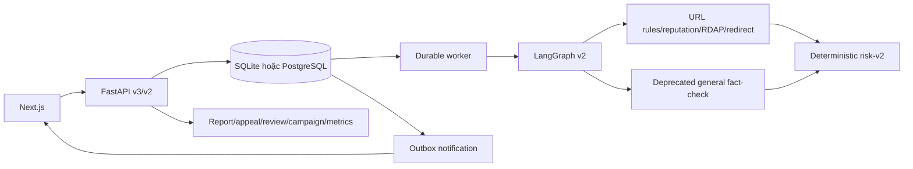

# TrustGuard AI — Architecture Entry Point

- [Product scope](docs/scope.md): goal và boundary canonical.
- [Implementation status](docs/implementation-status.md): phần đã implement, partial, deprecated và
  backlog được xác nhận từ code.
- [Detailed architecture](docs/01-ARCHITECTURE.md): runtime hiện tại và kiến trúc đích.

## Hiện tại



Hạ tầng API, auth, persistence, durable processing, URL safety, realtime và admin workflow đã có.
Product semantics vẫn là scope cũ: không có security scope gate, multi-turn, whitelist/brand matcher
hay bounded OfficialClaimVerifier; frontend vẫn là “Fact-Check AI”.

## Đích

```text
security scope gate
→ structured scam understanding
→ URL/domain + brand + whitelist/blacklist investigation
→ bounded official verification khi thật sự cần
→ deterministic security risk
→ grounded chat warning
→ reviewed wide action
```

Không coi module/table fact-check legacy là capability của scope mới. Việc drop schema chỉ diễn ra sau
cutover, zero-usage observation và backup/restore verification.
