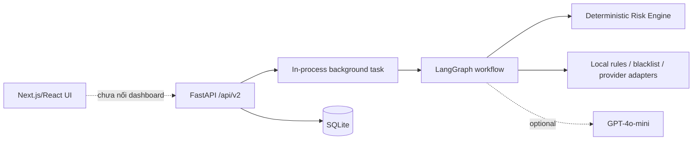
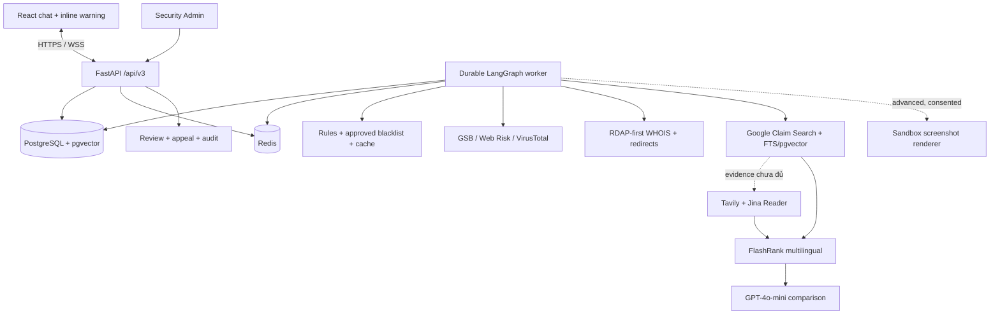

# TrustGuard AI — Architecture Entry Point

Tài liệu kiến trúc canonical nằm tại [docs/01-ARCHITECTURE.md](docs/01-ARCHITECTURE.md). File này
tóm tắt boundary quan trọng để README, slide và reviewer không nhầm kiến trúc đích với runtime hiện
tại.

## Kiến trúc hiện tại

Backend vertical slice, contract v2, SQLite repository và agent workflow đã tồn tại. Frontend chính
vẫn còn simulation/hard-coded data; progress event hiện được đọc bằng polling và chưa phản ánh mọi
transition theo thời gian thực.

## Kiến trúc đích

Đường URL ưu tiên local rule, approved blacklist và cached reputation để tạo cảnh báo sơ bộ. Đường
claim chạy Google Fact Check Claim Search và PostgreSQL FTS/pgvector trước; Google chỉ tìm các
ClaimReview đã tồn tại. Tavily Search và Jina Reader chỉ chạy khi deterministic sufficiency gate cho
biết evidence chưa đủ. FlashRank multilingual rerank candidate; GPT-4o-mini so sánh top 5 thành
stance có citation; Risk Engine vẫn quyết định score/verdict/action deterministic.

`/api/v2` là contract runtime hiện tại và được giữ read-compatible trong release v3 đầu tiên;
frontend final product dùng `/api/v3`.

## Trust boundaries

- User chỉ gửi message/URL đã chọn; hệ thống không đọc nền toàn bộ hội thoại và không phá E2E.
- URL/domain lookup và screenshot cần consent; dữ liệu gửi provider phải được tối thiểu hóa.
- Claim gửi embeddings/fact-check/comparison phải được redact và giới hạn ở phần text tối thiểu;
  raw message, OTP, secret và prompt không được ghi vào usage/log.
- Source Registry quyết định eligibility: Tier A/B có thể tạo kết luận, Tier C chỉ corroborate và
  Untrusted chỉ dùng discovery, bị loại trước fetch/comparator.
- Redirect/screenshot chạy sau SSRF guard, trong môi trường cô lập, không cookie hay credential.
- Individual warning được hiển thị ngay; domain block và broad warning luôn chờ admin phê duyệt.
- Redis là broker/cache/event fan-out, không phải source of truth; PostgreSQL giữ state và audit.

Xem tài liệu canonical để biết lifecycle, contract boundary, hiện trạng adapter và roadmap migration.
