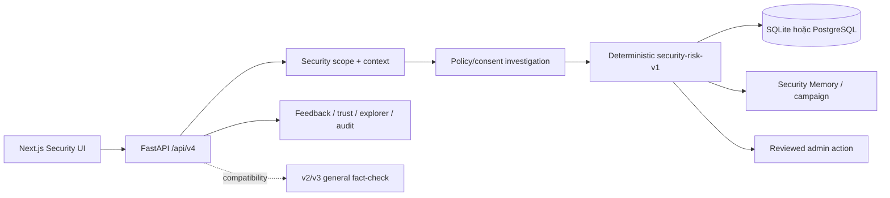

# TrustGuard AI — Architecture Entry Point

- [Product scope](docs/scope.md): goal và boundary canonical.
- [Implementation status](docs/implementation-status.md): phần đã implement, partial, deprecated và
  backlog được xác nhận từ code.
- [Detailed architecture](docs/01-ARCHITECTURE.md): runtime hiện tại và kiến trúc đích.

## Hiện tại



Security v4 đã có scope gate, multi-turn, trust/whitelist, bounded official verification, deterministic
risk, Security Memory, admin feedback, explorer và audit API. Review Room đọc privacy-minimized admin case
detail v4 trước feedback decision; reviewed action execution tạm tái sử dụng contract v3 có nhãn riêng trong
compatibility window. Frontend đã hoàn tất workspace, Trust lifecycle và Unified Audit trên contract v4;
metrics/source discovery v3 nằm trong compatibility surface có nhãn riêng, còn `/admin` chuyển sang Review Room.
WP9 tổng thể và legacy cleanup vẫn chờ hosted evaluation, telemetry và backup/restore evidence.

## Đích

```text
security scope gate
→ structured scam understanding
→ URL/domain + brand + whitelist/blacklist investigation
→ bounded official verification khi thật sự cần
→ deterministic security risk
→ grounded chat warning
→ reviewed wide action
```

Không coi module/table fact-check legacy là capability của scope mới. Việc drop schema chỉ diễn ra sau
cutover, zero-usage observation và backup/restore verification.
