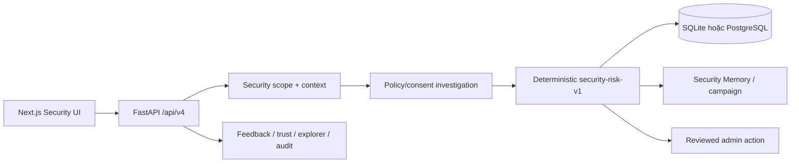

# TrustGuard AI — Architecture Entry Point

- [Product scope](docs/scope.md): goal và boundary canonical.
- [Implementation status](docs/implementation-status.md): phần đã implement, partial, deprecated và
  backlog được xác nhận từ code.
- [Detailed architecture](docs/01-ARCHITECTURE.md): runtime hiện tại và kiến trúc đích.

## Hiện tại



Security v4 đã có scope gate, multi-turn, brand/whitelist trust matching, deterministic
risk, Security Memory, admin feedback, explorer và audit API. Review Room đọc privacy-minimized admin case
detail v4 trước feedback decision; reviewed action execution đã chuyển sang `/api/v4/admin/actions`.
Public API v2/v3, frontend compatibility surface và pgvector persistence đã được gỡ. WP9 hosted
evaluation và backup/restore evidence vẫn còn là release gate.

## Đích

```text
security scope gate
→ structured scam understanding
→ URL/domain + brand + whitelist/blacklist investigation
→ deterministic security risk
→ grounded chat warning
→ reviewed wide action
```

Không coi module/table fact-check legacy là capability của scope mới. Migration cleanup phải được áp dụng
sau khi backup database hiện hữu vì không hỗ trợ downgrade.
