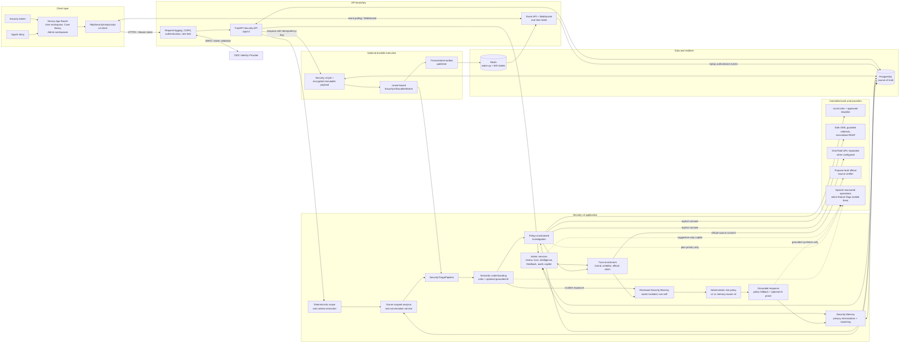
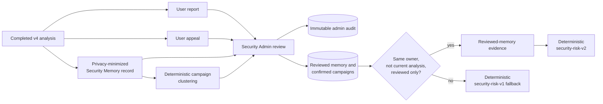

# Architecture Diagram — Security Triage v4

Tài liệu này mô tả kiến trúc và data flow **đang được sử dụng** của TrustGuard AI, đối chiếu trực tiếp từ frontend, `/api/v4`, service pipeline, worker và migrations hiện tại.

## Phạm vi

- Bao gồm Security Triage v4 cho người dùng, luồng quản trị v4, inline/async execution, realtime và Security Memory.
- Không biểu diễn `/api/v2`, general-analysis `/api/v3`, legacy LangGraph fact-check, source discovery/corpus, legacy campaign/worker, pgvector và frontend compatibility.
- Reviewed-action contract v3 cũng không được đưa vào sơ đồ vì vẫn thuộc compatibility window, dù backend hiện còn gọi bước đề xuất action sau phân tích.
- PostgreSQL là cấu hình persistence đầy đủ. SQLite/in-memory chỉ là fallback cho development/test và không phải topology production trong sơ đồ.

## Component diagram



## Data flow — một lượt phân tích

```mermaid
sequenceDiagram
    autonumber
    actor U as Người dùng
    participant FE as Next.js frontend
    participant API as FastAPI /api/v4
    participant Auth as Auth + rate limit
    participant Scope as Scope service
    participant Store as Analysis / conversation service
    participant Pipe as Security pipeline
    participant Tools as Local + consented providers
    participant DB as PostgreSQL
    participant Worker as Security v4 worker
    participant RT as Outbox + Redis + WebSocket

    U->>FE: Gửi nội dung cần đánh giá
    FE->>API: GET /capabilities
    FE->>API: POST /analyses<br/>consent + conversation version
    API->>Auth: Xác thực owner và giới hạn tốc độ
    Auth-->>API: Principal
    API->>Scope: Phân loại phạm vi bằng rule
    Scope-->>API: Scope decision + normalized context

    alt Inline execution
        API->>Store: Begin turn + optimistic conversation version
        Store->>DB: Persist conversation snapshot
        API->>Pipe: Enrich và đánh giá
        Pipe->>Pipe: Semantic understanding
        alt Scope cuối là ngoài phạm vi hoặc cần thêm thông tin
            Pipe-->>API: Boundary hoặc follow-up result
        else Đã có incident exposure
            Pipe->>DB: Reviewed-memory lookup nếu bật
            Pipe->>Pipe: Deterministic risk + recovery-first response
        else Chưa xảy ra incident
            Pipe->>Tools: Local checks
            opt Có consent và provider được cấu hình
                Pipe->>Tools: DNS / redirect / RDAP / reputation / official verification
            end
            Pipe->>DB: Trust registry + reviewed-memory lookup
            Pipe->>Pipe: Deterministic risk + grounded response
        end
        API->>DB: Persist result, events, conversation
        opt Result có risk
            API->>DB: Upsert privacy-minimized memory + campaign hypotheses
        end
        API-->>FE: SecurityScopeResponseV4
    else Async capability enabled
        API->>DB: Atomic enqueue: analysis, conversation,<br/>encrypted payload, job, idempotency record, outbox
        API-->>FE: 202 analysis_id + conversation version
        FE->>API: POST /ws-tickets
        FE->>RT: Connect stream with one-time ticket
        Worker->>DB: Claim job with lease
        Worker->>Pipe: Chạy cùng SecurityTriagePipeline
        opt Scope sau understanding là in-scope và không phải incident
            Pipe->>Tools: Các lookup được policy/consent cho phép
        end
        Worker->>DB: Append progress; commit final result,<br/>memory/campaign and outbox
        RT->>RT: Redis wake-up notification
        RT->>DB: Đọc event theo cursor
        RT-->>FE: Progress / final events
        FE->>API: GET /analyses/{analysis_id}
        API->>DB: Đọc kết quả owner-scoped
        API-->>FE: Kết quả hoàn chỉnh
    end
```

## Data flow — feedback và reviewed intelligence



## Quy tắc kiến trúc chính

1. **Product boundary:** frontend nghiệp vụ gọi `/api/v4`; out-of-scope kết thúc trong Security v4, không chuyển sang general fact-check.
2. **Deterministic authority:** AI chỉ bổ sung semantic fields, ưu tiên plan, diễn đạt phản hồi hoặc hỗ trợ admin. Scope/risk, consent, tool policy và action an toàn vẫn do rule/policy quyết định; output AI không grounded bị loại.
3. **Consent and SSRF safety:** network lookup chỉ chạy khi có consent; URL được normalize, kiểm tra local/SSRF trước và có budget, deadline, retry cùng execution ledger.
4. **Owner isolation:** analysis, conversation, report, appeal và reviewed-memory lookup đều giới hạn theo principal; admin endpoint yêu cầu role `security_admin`.
5. **Durability:** async dùng payload mã hóa, idempotency key, job lease, event log và transactional outbox. Async worker gọi `SecurityTriagePipeline`; inline route orchestration cùng các stage nghiệp vụ theo thứ tự tương đương.
6. **Realtime correctness:** Redis chỉ phát tín hiệu đánh thức và lưu WS ticket ngắn hạn; client luôn replay event có cursor từ PostgreSQL.
7. **Privacy and review gate:** conversation được redacted; Security Memory chỉ giữ fingerprint/tín hiệu tối thiểu. Chỉ memory đã review và campaign đã xác nhận mới có thể ảnh hưởng lượt phân tích sau.

## Ánh xạ component vào code

| Component | Implementation chính |
|---|---|
| Next.js workspace và v4 client | `frontend/src/app`, `frontend/src/components`, `frontend/src/lib/api/http-security-analysis-api.ts` |
| User turn state + realtime | `frontend/src/lib/hooks/use-security-case.ts`, `frontend/src/lib/api/security-event-stream.ts` |
| Security API v4 | `src/api/security_v4.py` |
| Auth, dependency wiring, worker startup | `src/api/dependencies.py`, `src/core/auth.py`, `src/core/rate_limit.py` |
| Scope và adaptive conversation | `src/services/security_triage.py`, `src/services/security_analysis.py`, `src/services/security_conversation_policy.py` |
| Shared processing pipeline | `src/services/security_pipeline.py` |
| Understanding, investigation, trust, risk, response | `src/services/security_understanding.py`, `src/agents/security_investigation.py`, `src/agents/security_trust.py`, `src/agents/security_risk.py`, `src/services/security_response.py` |
| Reviewed intelligence | `src/services/security_memory.py`, `src/agents/tools/security_memory.py`, `src/agents/campaign.py` |
| PostgreSQL repository | `src/repositories/postgres.py` |
| Durable jobs, outbox, retention | `src/services/durable_worker.py` |
| WebSocket ticket và notification | `src/services/realtime.py` |
| AI provider/runtime guardrails | `src/security_ai/openai.py`, `src/security_ai/runtime.py`, `src/security_ai/contracts.py` |
