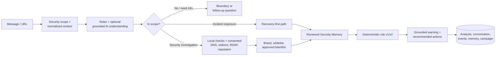

# TrustGuard AI — Security Triage Assistant

TrustGuard AI là trợ lý hội thoại giúp người dùng đánh giá tin nhắn và URL đáng ngờ trước khi thực hiện hành động có thể làm mất tiền, tài khoản hoặc dữ liệu. Runtime chính là **Security Triage API v4**: phân loại phạm vi, điều tra theo consent, tạo bằng chứng, tính risk bằng policy xác định và trả lời có grounding.

> Product flow hiện tại chỉ cung cấp Security v4 tại `/api/v4`; public API v2/v3 và vector-search compatibility đã được gỡ bỏ.

## Flow hiện tại



- Lượt intake/follow-up của case bảo mật gọi `POST /api/v4/analyses`.
- Sau khi đã có verdict, frontend gửi câu hỏi hội thoại thông thường qua `POST /api/v4/chat`; nếu router chọn `security_analysis`, frontend mở một analysis v4 mới.
- Inline là chế độ mặc định. Async chỉ được quảng bá khi PostgreSQL, durable worker và feature flag đều sẵn sàng.
- Async dùng job lease, encrypted payload, idempotency key, event log và transactional outbox.
- PostgreSQL là source of truth; Redis chỉ giữ WebSocket ticket ngắn hạn và phát wake-up notification. Client có polling fallback và replay event theo cursor.
- Chỉ Security Memory đã được admin review và campaign đã xác nhận mới có thể ảnh hưởng risk của lượt sau; lookup luôn owner-scoped và không dùng chính analysis hiện tại.

Xem sơ đồ chi tiết tại [Architecture_diagram.md](Architecture_diagram.md).

## Tính năng chính

- Security scope gate, structured context và multi-turn conversation có optimistic versioning.
- Local URL rules, approved blacklist, SSRF guard, DNS, redirect resolution, RDAP và VirusTotal reputation khi được cấu hình.
- Brand registry và whitelist có provenance.
- Risk policy xác định: `SAFE`, `LOW_RISK`, `SUSPICIOUS`, `HIGH_RISK`, `MALICIOUS`, `INSUFFICIENT_EVIDENCE`.
- Grounded assistant response; AI output không hợp lệ hoặc không grounded tự động rơi về policy response.
- Owner-isolated history, reports, appeals, event replay và WebSocket stream.
- Admin Review, Trust registry, Security Memory, campaign review, intelligence views, unified audit và suggestion-only Admin Copilot.
- SQLite/in-memory fallback cho development/test; PostgreSQL + Redis cho durable/production topology.

## Yêu cầu

- Python 3.11+
- [uv](https://docs.astral.sh/uv/) — khuyến nghị, hoặc `venv` + `pip`
- Node.js 22+ và npm
- Docker + Docker Compose nếu chạy full stack

## Quick start — local inline

Flow này dùng SQLite, demo auth và deterministic Security v4; không cần PostgreSQL, Redis hay API key bên ngoài.

### 1. Backend

```bash
cp .env.example .env
uv sync
uv run uvicorn src.main:app --reload --host 0.0.0.0 --port 8000
```

Nếu không dùng `uv`:

```bash
python3 -m venv .venv
source .venv/bin/activate
pip install -r requirements-dev.txt
uvicorn src.main:app --reload --host 0.0.0.0 --port 8000
```

Backend local mặc định:

- API: <http://localhost:8000>
- OpenAPI/Swagger: <http://localhost:8000/docs>
- Health: <http://localhost:8000/health>
- Readiness: <http://localhost:8000/health/ready>
- User token: `dev-user-token`
- Security Admin token: `dev-admin-token`

### 2. Frontend

Mở terminal khác:

```bash
cp frontend/.env.example frontend/.env.local
cd frontend
npm ci
npm run dev
```

Trong `frontend/.env.local`, bật demo token cho local development:

```dotenv
NEXT_PUBLIC_API_URL=http://localhost:8000
NEXT_PUBLIC_DEMO_USER_TOKEN=dev-user-token
NEXT_PUBLIC_DEMO_ADMIN_TOKEN=dev-admin-token
```

Mở <http://localhost:3000>. Không đưa demo token vào hosted/production build.

## Full stack bằng Docker Compose

```bash
cp .env.example .env
docker compose up --build -d
docker compose ps
curl http://localhost:8000/health/ready
```

Services:

| Service | Địa chỉ | Vai trò |
|---|---|---|
| Frontend | <http://localhost:3000> | Next.js application |
| Backend | <http://localhost:8000> | FastAPI `/api/v4` |
| PostgreSQL | internal `postgres:5432` | Source of truth và durable records |
| Redis | internal `redis:6379` | Realtime wake-up và WS tickets |
| Worker | internal | Durable worker, outbox publisher, retention |

Compose tự chạy `alembic upgrade head` trước khi khởi động backend. Cấu hình mặc định vẫn chạy analysis inline vì `SECURITY_ASYNC_EXECUTION_ENABLED=false`.

## Deploy production trên Railway

Repo có config-as-code riêng cho frontend, backend và worker. Topology production dùng
Railway PostgreSQL + Redis trong cùng project, OIDC thật và chỉ public frontend/backend.
Xem [Railway deployment runbook](docs/RAILWAY_DEPLOYMENT.md) để cấu hình root directory,
config path, reference variables, domain, migration, smoke test và rollback.

Dừng stack:

```bash
docker compose down
```

`docker compose down -v` xóa cả PostgreSQL/Redis volumes và không thể khôi phục nếu chưa backup.

## Environment variables

Toàn bộ giá trị mẫu nằm trong [.env.example](.env.example) và [frontend/.env.example](frontend/.env.example). Các biến dưới đây là những biến tác động trực tiếp tới flow Security v4.

### Runtime và storage

| Biến | Mặc định | Ý nghĩa |
|---|---:|---|
| `APP_ENV` | `development` | `development`, `test` hoặc `production`; production bật validation nghiêm ngặt. |
| `APP_HOST` / `APP_PORT` | `0.0.0.0` / `8000` | Bind address của backend khi dùng trong launcher riêng. |
| `CORS_ORIGINS` | `http://localhost:3000` | Danh sách origin phân cách bằng dấu phẩy; production chỉ chấp nhận HTTPS origin cụ thể. |
| `DATABASE_URL` | `sqlite:///./data/app.db` | PostgreSQL bắt buộc cho production và async execution. |
| `SECURITY_DATABASE_PATH` | `./data/security.db` | SQLite Security v4 fallback cho local/test. |
| `DATABASE_ENCRYPTION_KEY` | development placeholder | Khóa mã hóa durable payload; production cần secret riêng dài tối thiểu 32 ký tự. |
| `REDIS_URL` | `redis://localhost:6379/0` | Notification, distributed rate limit và WS ticket trong production. |
| `RUN_DURABLE_WORKER` | `true` | Chạy worker/outbox/retention trong process hiện tại khi repository là PostgreSQL. |
| `SECURITY_ASYNC_EXECUTION_ENABLED` | `false` | Cho phép request `execution_mode=async` khi durable runtime thực sự ready. |
| `JOB_LEASE_SECONDS` | `60` | Thời hạn lease của durable job. |
| `SECURITY_CONVERSATION_RETENTION_DAYS` | `30` | Thời gian giữ conversation summary đã redacted. |
| `CONTENT_RETENTION_DAYS` | `30` | Thời gian giữ nội dung phân tích đã tối giản trước retention cleanup. |
| `LOG_LEVEL` | `INFO` | Structured application logging. |

### Authentication và abuse controls

| Biến | Mặc định | Ý nghĩa |
|---|---:|---|
| `DEMO_AUTH_ENABLED` | `true` | Chỉ dùng local/test; production bắt buộc `false`. |
| `DEMO_USER_TOKEN` | `dev-user-token` | Bearer token của local user. |
| `DEMO_ADMIN_TOKEN` | `dev-admin-token` | Bearer token của local Security Admin. |
| `OIDC_ISSUER` / `OIDC_AUDIENCE` | rỗng | Bắt buộc khi demo auth tắt. |
| `OIDC_JWKS_URL` | issuer JWKS | Optional override cho JWKS endpoint. |
| `OIDC_ROLES_CLAIM` | `roles` | Claim chứa roles. |
| `OIDC_ADMIN_ROLE` | `security_admin` | Role được ánh xạ sang Security Admin. |
| `USER_RATE_LIMIT_PER_MINUTE` | `120` | Limit riêng cho user. |
| `ADMIN_RATE_LIMIT_PER_MINUTE` | `60` | Limit riêng cho admin. |
| `WEBSOCKET_TICKET_TTL_SECONDS` | `60` | TTL của one-time stream ticket. |

Frontend hosted dùng Authorization Code + PKCE. Cần ít nhất:

```dotenv
NEXT_PUBLIC_API_URL=https://api.example.com
NEXT_PUBLIC_OIDC_ISSUER=https://your-tenant.auth0.com/
NEXT_PUBLIC_OIDC_CLIENT_ID=your-public-spa-client-id
NEXT_PUBLIC_OIDC_AUDIENCE=https://api.example.com
NEXT_PUBLIC_OIDC_REDIRECT_URI=https://app.example.com/auth/callback
```

### Security AI feature flags

Mọi flag AI mặc định tắt. Khi bật bất kỳ AI operation nào trong production, phải có `OPENAI_API_KEY` và model configuration hợp lệ.

| Biến | Mặc định | Stage được bật |
|---|---:|---|
| `SECURITY_AI_UNDERSTANDING_ENABLED` | `false` | Structured semantic understanding có source spans/confidence. |
| `SECURITY_AI_PLANNING_ENABLED` | `false` | Chỉ ưu tiên deterministic plan; không được tạo target/tool mới. |
| `SECURITY_AI_EXPLANATION_ENABLED` | `false` | Synthesis có grounding; failure quay về policy response. |
| `SECURITY_ADMIN_COPILOT_ENABLED` | `false` | Gợi ý cho admin, không tự thực thi action. |
| `SECURITY_MEMORY_RETRIEVAL_ENABLED` | `false` | Dùng reviewed, owner-scoped memory và risk policy v2. |
| `OPENAI_API_KEY` | rỗng | Credential của AI provider. |
| `SECURITY_AI_SMALL_MODEL` | `gpt-4o-mini` | Understanding và planning model. |
| `SECURITY_AI_SYNTHESIS_MODEL` | `gpt-4o-mini` | Response/copilot synthesis model. |
| `SECURITY_AI_MAX_CALLS_PER_TURN` | `4` | Tổng call budget cho một turn. |
| `SECURITY_AI_TIMEOUT_SECONDS` | `12` | Timeout mỗi AI call. |
| `SECURITY_AI_TURN_DEADLINE_SECONDS` | `15` | Deadline chung của turn AI. |

### Investigation providers

| Biến | Mặc định | Ý nghĩa |
|---|---:|---|
| `VIRUSTOTAL_API_KEY` | rỗng | Bật URL reputation provider. |
| `PROVIDER_TIMEOUT_SECONDS` | `10` | Timeout adapter bên ngoài. |
| `SECURITY_INVESTIGATION_MAX_EXTERNAL_CALLS` | `8` | Network-call budget của một analysis. |
| `SECURITY_INVESTIGATION_MAX_RETRIES` | `1` | Retry budget. |
| `SECURITY_INVESTIGATION_DEADLINE_SECONDS` | `20` | Deadline của investigation. |
| `LIVE_PROVIDERS_REQUIRED` | `false` | Fail fast nếu provider bắt buộc chưa được cấu hình. |

DNS, redirect và RDAP không cần API key nhưng chỉ chạy khi request cấp `external_url_lookup=true`. Provider no-hit/error không được suy diễn thành `SAFE`.

## Sample API queries

Các ví dụ sau dùng demo auth local:

```bash
export API_URL=http://localhost:8000
export USER_TOKEN=dev-user-token
export ADMIN_TOKEN=dev-admin-token
```

### Health và capabilities

```bash
curl "$API_URL/health"
curl "$API_URL/health/ready"
curl "$API_URL/api/v4/capabilities"
```

`capabilities` là nguồn quyết định frontend có dùng async/AI/reviewed-memory capability hay không; không nên suy ra capability chỉ từ một flag đơn lẻ.

### Inline security analysis

Không cấp network consent — chỉ local checks và internal trust data:

```bash
curl -sS -X POST "$API_URL/api/v4/analyses" \
  -H "Authorization: Bearer $USER_TOKEN" \
  -H "Content-Type: application/json" \
  -d '{
    "message": "Ngân hàng yêu cầu tôi gửi OTP và đăng nhập tại https://secure-check.example/login",
    "execution_mode": "inline",
    "consent": {
      "external_url_lookup": false
    }
  }'
```

Response quan trọng gồm `analysis_id`, `conversation_id`, `conversation_version`, `scope_decision`, `security_context`, `evidence`, `risk`, `recommended_actions`, `assistant_response` và `limitations`.
```

## Database migrations

Với PostgreSQL ngoài Compose:

```bash
uv run alembic upgrade head
uv run alembic current
uv run alembic heads
```

Migration `0018_remove_vector_compat` dọn fact-check/vector/source-discovery storage đã nghỉ hưu. Hãy backup trước khi áp dụng trên database đã có dữ liệu vì migration này không hỗ trợ downgrade.

## Kiểm thử

Backend:

```bash
uv run ruff check .
uv run pytest -q
uv run alembic heads
```

Frontend:

```bash
cd frontend
npm test
npm run lint
npm run typecheck
npm run check:cutover
npm run build
npm run test:e2e
```

Offline security evaluation và rollout guard:

```bash
uv run python scripts/evaluate_security_v4.py
uv run python scripts/evaluate_security_memory_v2.py
uv run python scripts/evaluate_security_ai.py
uv run python scripts/check_security_ai_rollout.py --target-stage off
```

Offline pass không thay thế hosted OIDC/provider/PostgreSQL/Redis/load/backup-restore evidence.

## Production checklist tối thiểu

- `APP_ENV=production`, `DEMO_AUTH_ENABLED=false`.
- PostgreSQL và Redis URLs thật; chạy migrations trước traffic.
- HTTPS OIDC issuer/audience và frontend Authorization Code + PKCE configuration.
- `DATABASE_ENCRYPTION_KEY` không phải placeholder và dài tối thiểu 32 ký tự.
- `CORS_ORIGINS` chỉ chứa HTTPS origins cụ thể.
- Chỉ bật từng AI/provider/memory/async flag sau evaluation tương ứng.
- Xác minh `/health/ready`, `/api/v4/capabilities`, worker lease, outbox, WebSocket fallback và retention.
- Backup/restore rehearsal trước schema cleanup hoặc cutover.

Chi tiết rollout, freeze và rollback: [WP9 Release Runbook](docs/WP9_RELEASE_RUNBOOK.md).

## Safety invariants

- Out-of-scope dừng trong Security v4, không tự chuyển sang general fact-check.
- AI không trực tiếp đặt risk, score, consent hoặc tự tạo network target.
- Network lookup cần consent của từng request; consent không được kế thừa qua conversation.
- SSRF guard chặn private/local/metadata targets và revalidate redirect.
- Provider no-hit, timeout hoặc thiếu evidence không tự tạo verdict `SAFE`.
- URL đáng ngờ được hiển thị như text, không khuyến khích click.
- Owner isolation được kiểm tra trước khi đọc analysis/conversation/evidence.
- Admin Copilot chỉ gợi ý; quyết định cần người review và audit.

## Tài liệu

- [Architecture Diagram](Architecture_diagram.md) — component và data flow hiện tại, bỏ qua deprecated path.
- [Product Scope](docs/scope.md) — product goal và boundary.
- [Implementation Status](docs/implementation-status.md) — implemented, partial, deprecated và gaps.
- [Detailed Architecture](docs/01-ARCHITECTURE.md) — kiến trúc, persistence và cutover boundary.
- [API Contract](docs/02-CONTRACT_AND_FIXTURES.md) — contract và fixtures.
- [Release Runbook](docs/WP9_RELEASE_RUNBOOK.md) — hosted checks, migration cleanup và rollback.
