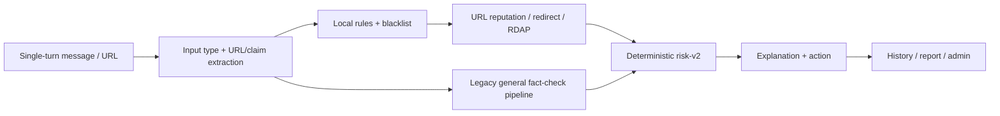

# TrustGuard AI — AI Security Triage Assistant

Goal của TrustGuard AI là trợ lý hội thoại đánh giá message/URL đáng ngờ có dấu hiệu phishing, scam
hoặc giả mạo trước khi user thực hiện hành động rủi ro. [Product Scope](docs/scope.md) là nguồn sự
thật về goal.

> Runtime hiện tại chưa đạt đầy đủ scope mới. Codebase vẫn vận hành theo luồng URL analysis + general
> fact-check cũ. Xem [Implementation Status](docs/implementation-status.md) để biết phần đã có, legacy
> và backlog thực tế.

## Trạng thái hiện tại

Đã implement và có thể tái sử dụng:

- FastAPI v2/v3, auth demo/OIDC, owner isolation, Security Admin RBAC và rate limiting.
- Single-turn text/URL analysis, URL normalization, local phishing rules và approved blacklist.
- Consent-gated URL reputation, guarded redirect, RDAP và SSRF protection.
- Deterministic risk scoring, provisional/final events, WebSocket + polling replay.
- SQLite local; PostgreSQL durable jobs/outbox, Redis delivery, retention và operations metrics.
- History, report/review queue, appeal, admin decision, campaign hypothesis và blacklist workflow.
- Next.js frontend gọi API thật, có history, report/appeal và admin operations.

Chưa đạt scope:

- Chưa có Security Scope Classifier; general fact-check request vẫn có thể chạy provider.
- Chưa có multi-turn conversation/case memory.
- Chưa có structured scam understanding đầy đủ hoặc threat taxonomy cho recruitment/payment/OTP.
- Chưa có brand registry/matcher và first-class whitelist.
- Chưa có bounded `OfficialClaimVerifier`; code vẫn dùng general fact-check/corpus/Tavily.
- Risk contract và UI vẫn dùng semantics cũ (`Fact-Check AI`, claim stance, low/medium/high/critical).
- Wide action mới có review contract/persistence; chưa có proposal/execution end-to-end.
- Chưa có evidence hosted production/live-provider/backup-load-security validation.

## Runtime hiện tại



Luồng `Legacy general fact-check pipeline` là deprecated theo scope mới. Kiến trúc đích và thứ tự
chuyển đổi nằm tại [Architecture](docs/01-ARCHITECTURE.md) và
[Implementation Plan](docs/03-IMPLEMENTATION_PLAN.md).

## Chạy local

Yêu cầu Python 3.11+, Node.js 22+ và npm.

```bash
uv sync
uv run playwright install chromium
cp .env.example .env
uv run uvicorn src.main:app --reload --port 8000
```

Nếu không dùng `uv`:

```bash
python3 -m venv .venv
source .venv/bin/activate
pip install -r requirements-dev.txt
playwright install chromium
```

Chạy frontend:

```bash
cd frontend
npm ci
npm run dev
```

Đặt `NEXT_PUBLIC_API_URL=http://localhost:8000` và `NEXT_PUBLIC_USE_MOCK_API=false` trong
`frontend/.env.local`. Swagger UI ở `http://localhost:8000/docs`.

## Docker Compose

```bash
cp .env.example .env
docker compose up --build -d
docker compose ps
```

- Frontend: `http://localhost:3000`
- API docs: `http://localhost:8000/docs`
- Readiness: `http://localhost:8000/health/ready`

Compose gồm frontend, API, worker, PostgreSQL/pgvector và Redis. Development có thể dùng demo auth;
production phải tắt demo token và cấu hình OIDC, signing/encryption keys, CORS và provider secrets.

```bash
docker compose down
```

`docker compose down -v` xóa named volumes và dữ liệu PostgreSQL/Redis.

## Kiểm thử

```bash
ruff check src tests
pytest -q
cd frontend
npm run lint
npm run typecheck
npm test
```

Kết quả audit 2026-08-13: backend 198 passed/1 skipped; frontend 30 passed; lint/typecheck pass. Đây là
test của runtime hiện tại, chưa phải acceptance suite đầy đủ cho scope mới.

## Tài liệu canonical

- [Product Scope](docs/scope.md) — goal và boundary.
- [Implementation Status](docs/implementation-status.md) — code đã có, partial, deprecated và gap.
- [Architecture](docs/01-ARCHITECTURE.md) — kiến trúc hiện tại và kiến trúc đích.
- [Contract](docs/02-CONTRACT_AND_FIXTURES.md) — contract đang chạy và migration cần thiết.
- [Implementation Plan](docs/03-IMPLEMENTATION_PLAN.md) — thứ tự công việc để đạt scope.
- [Database Status](docs/04-POSTGRESQL_ALEMBIC_PLAN.md) — schema hiện tại và migration legacy.

## Safety invariants đang áp dụng

- Không gọi URL/domain provider khi chưa có consent.
- SSRF guard chặn private/local/metadata target và revalidate redirect.
- Provider no-hit/error hoặc thiếu evidence không tự động tạo `SAFE`.
- LLM không trực tiếp ghi score/risk/action.
- URL đáng ngờ được hiển thị dạng text trong UI.
- Blacklist write qua flow hiện tại cần Security Admin decision và audit.
