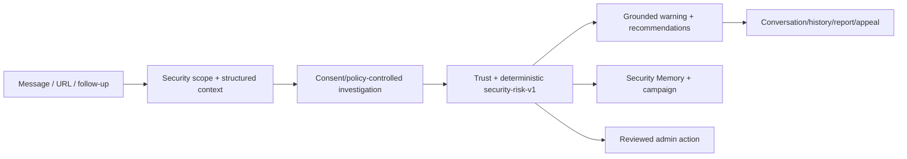

# TrustGuard AI — AI Security Triage Assistant

Goal của TrustGuard AI là trợ lý hội thoại đánh giá message/URL đáng ngờ có dấu hiệu phishing, scam
hoặc giả mạo trước khi user thực hiện hành động rủi ro. [Product Scope](docs/scope.md) là nguồn sự
thật về goal.

> Security Triage v4 và frontend investigation workspace đã được triển khai. WP9 đã có deterministic
> evaluation, cutover/freeze guard, compatibility checker và release
> runbook. Hosted OIDC/provider/PostgreSQL/Redis/load, restore rehearsal và zero-usage window vẫn chưa có evidence.
> Xem [Implementation Status](docs/implementation-status.md) để biết ranh giới chính xác.

## Trạng thái hiện tại

Đã implement và có thể tái sử dụng:

- FastAPI Security Triage `/api/v4` bên cạnh v2/v3 compatibility; auth demo/OIDC, owner isolation,
  Security Admin RBAC và rate limiting.
- Security scope gate, structured scam/threat context, multi-turn conversation và deterministic v4 risk.
- Text/URL analysis, URL normalization, local phishing rules, brand/whitelist và approved blacklist.
- Consent-gated URL reputation, guarded redirect, RDAP và SSRF protection.
- Typed evidence, bounded official verification, WebSocket + polling replay.
- SQLite local; PostgreSQL durable jobs/outbox, Redis delivery, retention và operations metrics.
- Paginated history/conversation/trust/memory/campaign API; report/appeal admin lifecycle, bounded admin
  case-detail, domain/threat intelligence, unified v4 audit và reviewed blacklist workflow.
- Next.js frontend gọi API thật, có case workspace/history, Observatory, Security Review Room, Trust lifecycle,
  Unified Audit và compatibility surface riêng cho v3 metrics/source discovery.

Chưa đạt scope:

- `BLOCK_DOMAIN`, `PUBLISH_BROAD_WARNING` và AI Security Copilot chưa có downstream sink thật.
- Legacy v2/v3 general fact-check/source-discovery writers chưa được freeze trên deployment thật hoặc cleanup;
  code đã có fail-fast cutover profile và legacy-write switch.
- Đã có versioned offline quality evaluation; chưa có compatibility zero-usage evidence và backup/restore rehearsal.
- Chưa có evidence hosted production/live-provider/backup-load-security validation.

## Runtime hiện tại



Legacy general fact-check pipeline không nằm trên Security v4 path nhưng vẫn tồn tại cho compatibility.
Kiến trúc và thứ tự cutover nằm tại [Architecture](docs/01-ARCHITECTURE.md) và
[Implementation Plan](docs/03-IMPLEMENTATION_PLAN.md).

## Chạy local

Yêu cầu Python 3.11+, Node.js 22+ và npm.

```bash
uv sync
uv run playwright install chromium
cp .env.example .env
uv run uvicorn src.main:app --reload --port 8000
```

Nếu không dùng `uv`:

```bash
python3 -m venv .venv
source .venv/bin/activate
pip install -r requirements-dev.txt
playwright install chromium
```

Chạy frontend:

```bash
cd frontend
npm ci
npm run dev
```

Đặt `NEXT_PUBLIC_API_URL=http://localhost:8000` và `NEXT_PUBLIC_USE_MOCK_API=false` trong
`frontend/.env.local`. Swagger UI ở `http://localhost:8000/docs`.

## Docker Compose

```bash
cp .env.example .env
docker compose up --build -d
docker compose ps
```

- Frontend: `http://localhost:3000`
- API docs: `http://localhost:8000/docs`
- Readiness: `http://localhost:8000/health/ready`

Compose gồm frontend, API, worker, PostgreSQL/pgvector và Redis. Development có thể dùng demo auth;
production phải tắt demo token và cấu hình OIDC, signing/encryption keys, CORS và provider secrets.
Frontend production dùng OIDC Authorization Code + PKCE tại `/auth/callback`; cấu hình tối thiểu
`NEXT_PUBLIC_OIDC_ISSUER`, `NEXT_PUBLIC_OIDC_CLIENT_ID`, `NEXT_PUBLIC_OIDC_AUDIENCE` và đăng ký callback/
logout/web origin ở Identity Provider. Danh sách override đầy đủ nằm trong `frontend/.env.example`.

```bash
docker compose down
```

`docker compose down -v` xóa named volumes và dữ liệu PostgreSQL/Redis.

## Kiểm thử

```bash
ruff check src tests
pytest -q
cd frontend
npm run lint
npm run typecheck
npm test
```

Kết quả gần nhất 2026-08-14: backend 315 passed/1 skipped; Ruff pass; frontend 88 test/18 files,
lint/typecheck/cutover check, Next.js Turbopack + webpack standalone production build và Chromium E2E 2 pass.
Đây chưa phải hosted release evidence.

## Tài liệu canonical

- [Product Scope](docs/scope.md) — goal và boundary.
- [Implementation Status](docs/implementation-status.md) — code đã có, partial, deprecated và gap.
- [Architecture](docs/01-ARCHITECTURE.md) — kiến trúc hiện tại và kiến trúc đích.
- [Contract](docs/02-CONTRACT_AND_FIXTURES.md) — contract đang chạy và migration cần thiết.
- [Implementation Plan](docs/03-IMPLEMENTATION_PLAN.md) — thứ tự công việc để đạt scope.
- [WP9 Release Runbook](docs/WP9_RELEASE_RUNBOOK.md) — preflight, hosted smoke, restore, compatibility window và rollback.
- [Database Status](docs/04-POSTGRESQL_ALEMBIC_PLAN.md) — schema hiện tại và migration legacy.

## Safety invariants đang áp dụng

- Không gọi URL/domain provider khi chưa có consent.
- SSRF guard chặn private/local/metadata target và revalidate redirect.
- Provider no-hit/error hoặc thiếu evidence không tự động tạo `SAFE`.
- LLM không trực tiếp ghi score/risk/action.
- URL đáng ngờ được hiển thị dạng text trong UI.
- Blacklist write qua flow hiện tại cần Security Admin decision và audit.
