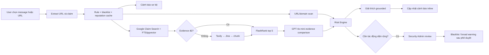

# TrustGuard AI — P-068

AI Agent phát hiện liên kết độc và tuyên bố đáng ngờ trong nội dung chat do người dùng chủ động gửi.
TrustGuard AI lập kế hoạch điều tra, thu thập bằng chứng từ rule, blacklist và provider uy tín, chấm
điểm rủi ro deterministic rồi giải thích cảnh báo bằng ngôn ngữ dễ hiểu.

> **Trạng thái:** Baseline hiện tại (2026-08-11, phát triển tiếp từ `7715ea0`) đã đóng runtime
> integration gate Wave 2. PostgreSQL hybrid retrieval, conditional Tavily/Jina, FlashRank,
> schema-bound comparator, campaign persistence, live progress/provisional events, source registry
> admin và topology API/worker/frontend đã được compose. Hosted rollout và live-provider smoke bằng
> secret thật vẫn là release gate Wave 3.

## Sản phẩm giải quyết gì?

Người dùng phổ thông khó tự đánh giá URL giả mạo, redirect, tuổi domain và độ xác thực của một
tuyên bố đang lan truyền. TrustGuard AI cung cấp:

- cảnh báo inline hai pha: cảnh báo sơ bộ nhanh từ rule/blacklist/cache, sau đó cập nhật kết luận khi
  tool và LLM hoàn tất;
- risk score, verdict, evidence, limitation và khuyến nghị rõ ràng;
- kiểm tra URL/domain qua adapter reputation và RDAP/WHOIS; fact-check claim bằng Google ClaimReview
  retrieval, PostgreSQL FTS/pgvector và Tavily/Jina fallback theo Source Registry;
- memory blacklist có nguồn gốc và audit;
- chuyển case nghiêm trọng cho Security Admin mà không trì hoãn cảnh báo cá nhân;
- Human-in-the-loop bắt buộc trước khi chặn domain hoặc phát cảnh báo diện rộng.

Hệ thống không đọc toàn bộ hội thoại, không phá mã hóa đầu cuối và không tự mở link trên thiết bị
người dùng. Chỉ nội dung được người dùng chủ động gửi mới được phân tích; external URL/domain lookup
cần consent rõ ràng.

## Luồng điều tra



LLM `gpt-4o-mini` hỗ trợ extract tối đa năm claim có temporal interval, so sánh evidence theo schema
và viết giải thích. OpenAI `text-embedding-3-small` tạo vector; FlashRank multilingual là ngoại lệ
local-model duy nhất và chỉ rerank. LLM comparison tạo stance có citation, còn score/verdict/action
vẫn do Risk Engine deterministic quyết định.

## Công nghệ và kiến trúc

| Lớp | Lựa chọn | Trạng thái |
|---|---|---|
| LLM | OpenAI `gpt-4o-mini` | Đã có, optional theo API key |
| Embedding | OpenAI `text-embedding-3-small` qua `/v1/embeddings` | Adapter đã có; batch tối đa 5 claim, re-embedding job đã có |
| Orchestration | LangGraph: extract → scan → verify → score → warn/escalate | Đã có vertical slice |
| URL reputation | Google Web Risk primary, VirusTotal policy-gated secondary | Đã wire; fake adapters mặc định trong test |
| Domain intelligence | RDAP-first/WHOIS; guarded redirect | Đã wire lazy sau consent |
| Fact-check retrieval | Google Fact Check Claim Search + PostgreSQL FTS/pgvector | Đã compose trong production worker |
| Web fallback | Tavily Search → Jina Reader → LangChain splitter | Chỉ chạy sau deterministic sufficiency miss |
| Rerank | FlashRank `ms-marco-MultiBERT-L-12` | Đã wire; Docker image preload model |
| Backend | FastAPI `/api/v3` + `/api/v2` compatibility | Product path v3 đang hoạt động |
| Frontend | Next.js/React với warning banner | Dashboard/history/appeal/platform admin gọi API thật |
| Realtime | Persisted event polling + ticketed WebSocket | Live step/provisional event được persist ngay khi graph chạy |
| Data | PostgreSQL/pgvector source of truth + Redis delivery | Migrations `0001`–`0007`, gồm campaign observations/vector và source bootstrap |
| Deploy | Docker Compose API + worker + frontend | Chạy thật local; Railway thuộc final scope |

Chi tiết: [kiến trúc](docs/01-ARCHITECTURE.md), [yêu cầu sản phẩm](docs/00-PRODUCT_REQUIREMENTS.md),
[contract](docs/02-CONTRACT_AND_FIXTURES.md) và [kế hoạch triển khai](docs/03-IMPLEMENTATION_PLAN.md).

## Phạm vi final product

### Core product

- App deploy, đăng nhập và hai vai trò `user`/`security_admin`.
- Phân tích URL hoặc message được người dùng chủ động gửi.
- Rule, approved blacklist, URL reputation, RDAP/WHOIS và fact-check retrieval.
- Risk score deterministic; cảnh báo inline kèm lý do, evidence, limitation và khuyến nghị.
- Lịch sử, user report và admin-managed blacklist có audit.
- Theo dõi progress realtime, polling fallback và bảo vệ rate-limit/cost.

### Advanced intelligence

- Fact-check optimized retrieval: Google ClaimReview + FTS/pgvector trước; chỉ fallback Tavily/Jina
  khi chưa đủ evidence, rồi FlashRank và comparison có citation.
- Screenshot renderer cô lập, không cookie/đăng nhập và chỉ chạy sau consent khi scan tĩnh chưa đủ.
- Phát hiện chiến dịch lan truyền theo cụm và dashboard xu hướng tin giả.
- Học có kiểm duyệt từ báo cáo người dùng; feedback không tự động đổi model/score.
- Dashboard chi phí API, quota/rate-limit và cơ chế appeal.

Core product và Advanced intelligence đều bắt buộc trước final release; cách gọi này chỉ phân nhóm
capability, không tạo một điểm dừng MVP. Việc triển khai được chia cho bốn coding agents tại
[Final Product Implementation Plan](docs/03-IMPLEMENTATION_PLAN.md).

## Chạy local

Yêu cầu Python 3.11+, Node.js 20+ và npm.

```bash
uv sync
uv run playwright install chromium
cp .env.example .env
uv run uvicorn src.main:app --reload --port 8000
```

`.env.example` mặc định dùng SQLite để lệnh trên chạy ngay mà không cần Docker. Nếu chọn PostgreSQL,
hãy chạy PostgreSQL/Redis, thay `DATABASE_URL`, rồi chạy `uv run alembic upgrade head` trước khi mở API.

Nếu không dùng `uv`, có thể tạo virtualenv và cài `requirements.txt` bằng `pip` như trước.

Ở terminal khác:

```bash
cd frontend
npm ci
npm run dev
```

Đặt `NEXT_PUBLIC_API_URL=http://localhost:8000` và `NEXT_PUBLIC_USE_MOCK_API=false` trong
`frontend/.env.local` khi kiểm thử HTTP integration. Swagger UI: `http://localhost:8000/docs`.

Để bật profile dữ liệu/provider thật, điền sáu khóa provider trong `.env`, đặt
`LIVE_PROVIDERS_REQUIRED=true`, rồi chạy `docker compose up --build`. Compose chạy migration, API,
durable worker, frontend, PostgreSQL/pgvector và Redis; readiness sẽ fail nếu database/Redis hoặc
provider profile bắt buộc chưa sẵn sàng trong production profile.

Sau khi các service healthy, chạy một smoke bằng claim/URL công khai đang cần kiểm chứng (script
không in lại message hay token):

```bash
LIVE_SMOKE_TOKEN="$OIDC_ACCESS_TOKEN" python scripts/live_provider_smoke.py \
  "Kiểm chứng tuyên bố hoặc URL công khai do operator chọn"
```

Docker Compose chạy `alembic upgrade head` trước backend. Khi `DATABASE_URL` là PostgreSQL, API dùng
PostgreSQL làm source of truth và worker tự reclaim lease hết hạn; Redis chỉ đánh thức/phân phối
event. SQLite vẫn là default offline nếu cấu hình `DATABASE_URL=sqlite:///...`.

SQLite file thực tế lấy từ `SECURITY_DATABASE_PATH`. PostgreSQL là runtime production cho durable
analysis, appeal/reviewed action, Source Registry, fact-check cache/corpus, campaign, usage metrics và
artifact retention. Các action nhạy cảm chỉ thay đổi blacklist sau decision transaction được duyệt.

Import dữ liệu development SQLite sau khi đã chạy `alembic upgrade head` (head hiện tại là
`0007_runtime_integration`):

```bash
python scripts/import_sqlite_to_postgres.py ./data/security.db \
  --database-url "$DATABASE_URL" --encryption-key "$DATABASE_ENCRYPTION_KEY"
```

## Kiểm thử

```bash
ruff check src tests
pytest -q
cd frontend
npm run lint
npm run typecheck
npm test
npm run build
```

Test mặc định phải chạy offline bằng fake adapters/fixtures, không tiêu tốn quota provider hoặc LLM.

## Nguyên tắc an toàn

- Không coi provider no-hit, timeout hoặc thiếu evidence là bằng chứng “an toàn”.
- Không log secret, OTP, raw message hoặc raw provider response.
- Không gọi URL/domain provider khi chưa có consent và không truy cập private/local/metadata IP.
- Không biến URL đáng ngờ thành link bấm trực tiếp trong UI.
- Chặn domain, thêm blacklist và cảnh báo diện rộng phải có Security Admin phê duyệt cùng audit.

## Tài liệu

- [Product Requirements](docs/00-PRODUCT_REQUIREMENTS.md)
- [Architecture](docs/01-ARCHITECTURE.md)
- [Contract and Fixtures](docs/02-CONTRACT_AND_FIXTURES.md)
- [Implementation Plan](docs/03-IMPLEMENTATION_PLAN.md)
- [Gate 1 Brief](docs/gate1/brief.md)
- [Gate 1 PRD](docs/gate1/prd.md)
- [Gate 1 UI Flow](docs/gate1/UI_flow.md)
