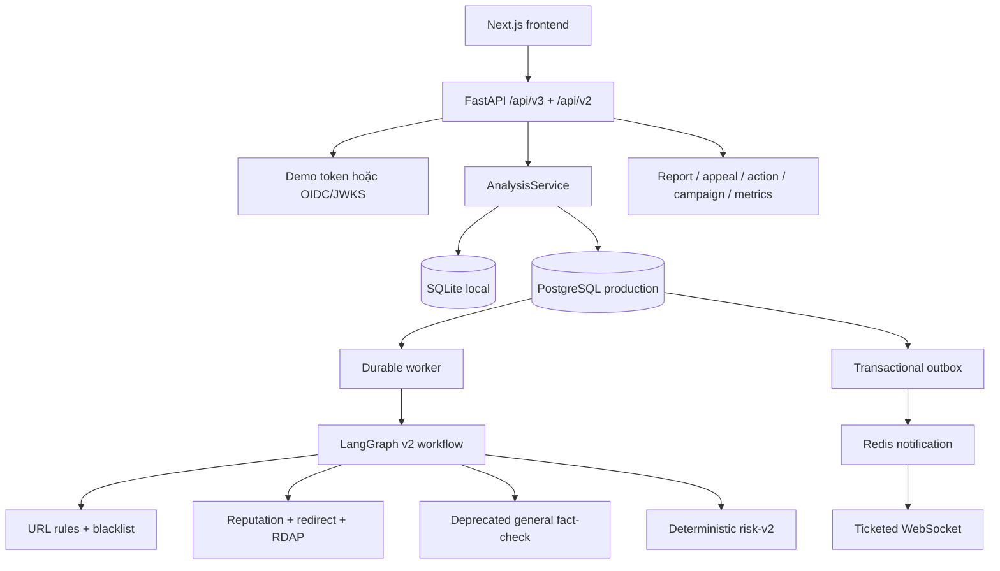
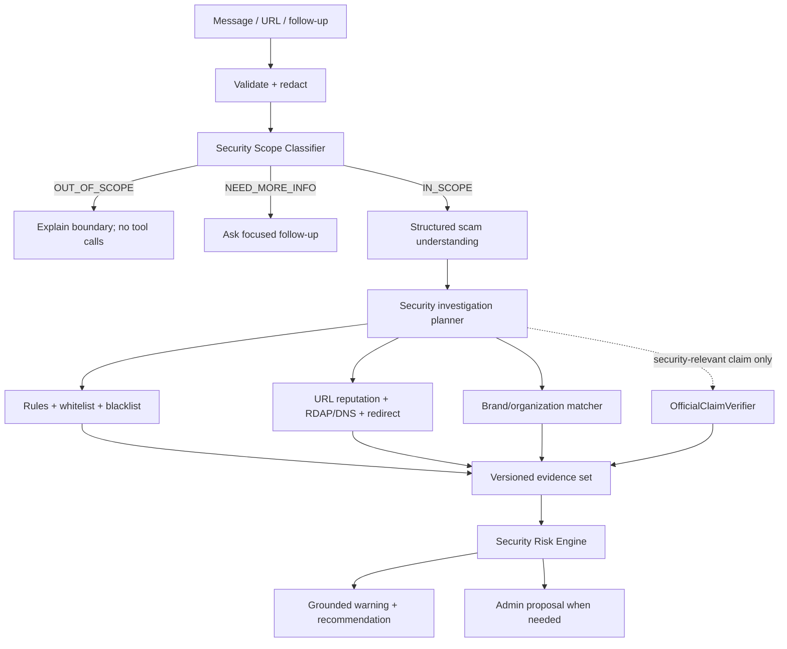

# Architecture — Current Runtime and Target

[scope.md](scope.md) định nghĩa goal; [implementation-status.md](implementation-status.md) định nghĩa
trạng thái code tại lần audit gần nhất.

## 1. Kiến trúc đang chạy



`AnalysisService` tạo job và persist lifecycle. Với PostgreSQL, worker claim job bằng lease và
idempotency; events được persist trước khi outbox đánh thức WebSocket. Với SQLite, analysis chạy bằng
background task trong process.

## 2. Workflow đang chạy

```text
classify_input
→ extract_indicators
→ normalize_and_check_rules
→ provisional_warning
→ LLM analyze_message
→ plan_tools
→ URL/domain/claim tools
→ general fact-check orchestrator
→ campaign detection
→ deterministic risk-v2
→ LLM review/explanation
→ route action
```

`classify_input` chỉ phân loại text/URL, không phải security scope gate. `extract_indicators` dùng URL
regex và claim marker, trong đó có cả medical/general-fact markers. Planner luôn thêm URL, domain và
claim retriever steps khi có target. Vì vậy workflow này chưa đáp ứng product boundary mới.

## 3. Thành phần reusable

- API/auth/ownership/rate-limit/logging boundaries.
- Analysis lifecycle, persistence, durable jobs, outbox và realtime replay.
- URL normalization, local credential-path/punycode/lure rules.
- Blacklist, URL reputation cascade, RDAP và guarded redirect.
- Tool budgets, deadline, retry và normalized provider errors.
- Deterministic scoring seam và grounded fallback seam.
- Report queue, appeal, campaign review, operations metrics và retention.

## 4. Kiến trúc đích theo scope



## 5. Delta bắt buộc

### Before tools

- Thêm scope decision vào state/contract và dừng graph sớm cho out-of-scope.
- Thêm `conversation_id` và case-memory summary có owner/retention.
- Thay claim-centric `MessageAnalysis` bằng organization/scenario/requested-action/payment/OTP schema.

### Investigation

- Thêm first-class whitelist và brand registry/matcher.
- Tách DNS evidence khỏi resolver nội bộ nếu DNS là output product.
- Thay general FactCheckOrchestrator bằng bounded OfficialClaimVerifier.
- Chuyển campaign similarity từ general-claim embeddings sang security fingerprint phù hợp.

### Risk/output

- Loại rule “claim refuted ⇒ malicious”.
- Map sang taxonomy scope: `SAFE`, `LOW_RISK`, `SUSPICIOUS`, `HIGH_RISK`, `MALICIOUS`,
  `INSUFFICIENT_EVIDENCE`.
- Enforce whitelist precedence và strong-evidence threshold cho malicious.

### Product/admin

- Thay fact-check form/results/history bằng multi-turn security chat.
- Thêm whitelist/domain/threat/audit admin views.
- Hoàn tất proposal → review → execute cho wide actions.

## 6. Trust boundaries hiện có

- External URL/domain work bị hard-gate bằng consent trong executor và tool node.
- SSRF guard chặn non-public target; redirect/screenshot revalidate destination.
- Request log chỉ ghi route, status, latency và request ID, không ghi body/query/token.
- OIDC access token được validate bằng issuer/audience/JWKS; production cấm demo auth.
- PostgreSQL giữ source of truth; Redis chỉ giữ queue/notification/ticket/rate-limit state.
- User read filter theo owner; admin route yêu cầu role.

Các boundary này cần được giữ khi thay workflow nghiệp vụ.

## 7. Deprecated boundaries

- `/api/v2/chat` starter graph và `/api/v2` contract sau compatibility window.
- Google Fact Check, Tavily, fact-check corpus/source discovery và claim comparator.
- Screenshot flow trừ khi scope được mở rộng rõ ràng.
- Frontend claim stance và Source Registry administration.
