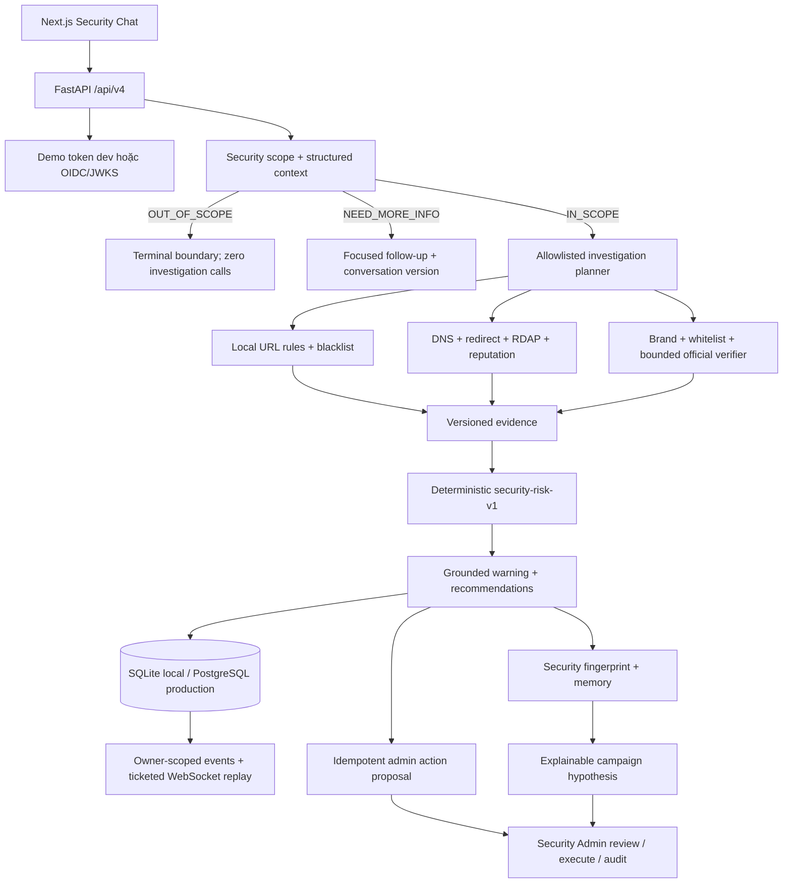

# Architecture — Current Security Runtime

[scope.md](scope.md) định nghĩa product goal; [implementation-status.md](implementation-status.md)
định nghĩa trạng thái code hiện tại; [SECURITY_TRIAGE_IMPLEMENTATION_PLAN.md](SECURITY_TRIAGE_IMPLEMENTATION_PLAN.md)
là nguồn theo dõi WP và release gate.

## 1. Hai product profile đang tồn tại

Runtime hiện có hai profile tách biệt:

- `/api/v4` là Security Triage product path mà frontend đang sử dụng.
- `/api/v2` và `/api/v3` là legacy analysis compatibility path. V3 admin review/action/metrics vẫn được
  v4 tái sử dụng ở những chỗ đã có hạ tầng đúng semantics.

Middleware chỉ phân loại route theo path/method để ghi `security_read/security_write` hoặc
`legacy_read/legacy_write`; không đọc body, query hay token. Việc freeze và xóa legacy writer thuộc WP9.

## 2. Kiến trúc Security v4 hiện tại



`POST /api/v4/analyses` hiện xử lý scope, investigation, trust enrichment và deterministic risk trong
request lifecycle, sau đó persist terminal snapshot và ba lifecycle event `queued/running/completed`
hoặc `failed`. Polling và WebSocket cung cấp owner-scoped replay; v4 chưa được chuyển sang durable worker
async như legacy PostgreSQL analysis path.

## 3. Security workflow và policy boundaries

```text
validate request/conversation version
→ scope decision + SecurityContextV4
→ terminal OUT_OF_SCOPE / NEED_MORE_INFO, hoặc investigation
→ local rules and consent-gated external tools
→ brand/whitelist/official trust enrichment
→ deterministic risk and grounded explanation
→ terminal persistence
→ HITL proposal and Security Memory producers
```

Các invariant đang enforce:

- Out-of-scope kết thúc trước khi resolve investigation hoặc legacy analysis service.
- Planner chỉ nhận normalized target từ `SecurityContextV4`; external URL lookup cần consent.
- DNS/redirect/reputation dùng SSRF guard; redirect revalidate từng hop.
- Brand và whitelist record có provenance, lifecycle, reviewer và policy version.
- Official verifier bị giới hạn purpose, một claim, tối đa hai query và năm official sources;
  `NOT_FOUND` không đồng nghĩa false hoặc malicious.
- Risk/score/action là deterministic policy output; LLM không có quyền tự ghi verdict.
- Whitelist chạy trước negative scoring; mismatch, domain age, provider no-hit hoặc timeout đứng riêng
  không đủ tạo `MALICIOUS`.

## 4. Conversation, persistence và privacy

`SecurityAnalysisService` quản lý owner-scoped analysis, report, appeal và conversation. Conversation
dùng optimistic `conversation_version`, redacted structured summary và retention interval. Raw private
message không được persist trong Security v4 analysis/memory.

SQLite là durable local/dev store. PostgreSQL là production source of truth và có Alembic schema đến
`0014_security_memory_campaigns`. Redis chỉ phục vụ rate limit/notification/ticket ở deployment có cấu
hình; không phải source of truth.

Security Memory chỉ giữ canonical domain, query-free URL fingerprint, redirect domain, claimed brand,
scenario/action pattern, threat/risk/policy version, timestamps, report count, admin verdict và evidence
refs. Campaign v4 cluster theo named security signals trong time window, không đọc claim embeddings.

## 5. Human-in-the-loop và admin

Completed `HIGH_RISK`/`MALICIOUS` URL analysis có thể tạo idempotent `ADD_TO_BLACKLIST` proposal liên kết
bằng `security_analysis_id`. Action bắt buộc canonical target, evidence snapshot, reviewer identity và
review note. State machine là:

```text
pending_review → rejected
pending_review → approved attempt → executed | failed
```

Chỉ `ADD_TO_BLACKLIST` có execution sink thật và ảnh hưởng lookup sau đó. `BLOCK_DOMAIN`,
`PUBLISH_BROAD_WARNING` và AI Copilot chưa có sink; approved attempt phải kết thúc `FAILED` với reason
code, không được giả là đã execute.

Admin product hiện có action/audit, brand, whitelist, Security Memory correction, campaign
review/audit, report/appeal và operations views. Dedicated domain/threat explorer và audit browser tổng
hợp vẫn là phần hoàn thiện/cutover của WP9.

## 6. Hạ tầng legacy còn được giữ

Legacy v2/v3 vẫn có `AnalysisService`, durable PostgreSQL worker, outbox, general fact-check providers,
claim corpus/embeddings, source discovery, screenshot artifacts và claim-vector campaign path. Chúng
không được Security v4 scope/investigation/memory path import hoặc gọi, nhưng chưa bị xóa để giữ
compatibility và rollback an toàn.

WP9 phải đo zero legacy reader/writer trong compatibility window, kiểm chứng backup/restore rồi mới
drop schema/pgvector, provider config, frontend compatibility components và routes deprecated.

## 7. Trust boundaries cần giữ khi cutover

- Request log không ghi body/query/token; persisted URL loại query khi không cần thiết.
- User read luôn filter theo owner; admin route yêu cầu `security_admin`.
- OIDC validate issuer/audience/JWKS; production không dùng demo token.
- External provider errors được normalize, bounded retry/deadline và không tự tạo safe verdict.
- Admin decision, execution result và evidence snapshot được audit bất biến.
- Schema removal chỉ diễn ra sau telemetry, backup/export và rollback rehearsal.
