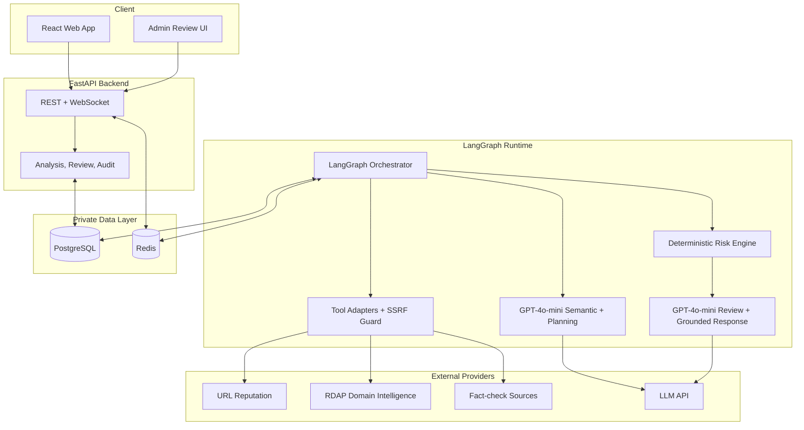
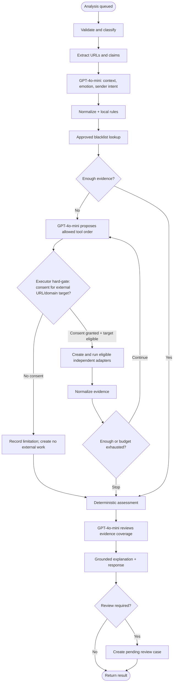
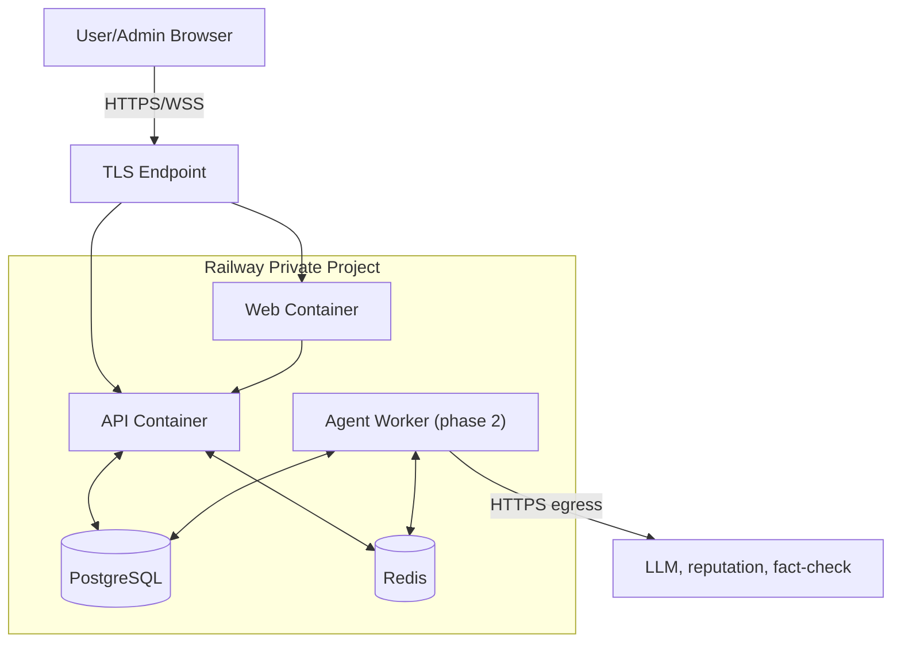

# Architecture — P-068

> Tài liệu này định nghĩa **hệ thống được tổ chức và chạy như thế nào**. Không định nghĩa lại scope sản phẩm, payload hay ownership.

## 1. System Overview



Dependency direction trong code: `api → application service → agents.graph → agents.tools protocol → adapter`.
Node không import provider SDK; API không biết raw provider response. Đây là topology đích; bước
đầu có thể chạy graph trong API process qua một processor interface, sau đó chuyển cùng interface
sang worker mà không đổi public contract.

## 2. Agent Flow



`plan_tools` tạo **kế hoạch tác vụ có cấu trúc**, không lưu chain-of-thought: mỗi bước chỉ gồm
`step_id`, `tool`, `target`, `reason_code`, `depends_on` và trạng thái. Executor, không phải LLM,
luôn chèn local rules/blacklist và chuẩn hóa target. Vòng lặp dừng khi evidence đủ, hết tool calls/retries, vượt time/cost budget hoặc không
còn tool phù hợp. LLM chỉ xếp ưu tiên các tool trong allowlist; code có quyền bổ sung tool
cần thiết hoặc phủ quyết kế hoạch vi phạm consent/SSRF/budget. Consent là hard gate của executor:
trước khi tạo task, mở provider client hoặc fan-out bất kỳ lookup URL/domain nào, executor phải
xác nhận `consent_to_scan_urls is true` và target đã qua policy/SSRF guard. Tool/LLM lỗi được chuẩn hóa
thành error/limitation và kích hoạt deterministic fallback; không trở thành tín hiệu an toàn.

## 3. Deployment



- Chỉ Web/API public; Worker, Redis và DB nằm trong private network.
- Phase 1: API gọi processor và phát status. Phase 2: API enqueue durable job; Worker thực thi
  graph và persist state/evidence.
- Secrets được inject server-side. Browser không gọi trực tiếp provider.
- CI build immutable images, chạy test/migration rồi deploy; DB dùng persistent storage và backup.
- Vertical slice đầu chạy processor trong API process và polling như code hiện tại; chỉ tách worker
  khi đã có durable job/outbox, idempotency key và recovery test. Redis không được coi là nguồn sự thật.
- `pgvector` không nằm trên đường găng: fact-check corpus hiện xếp hạng lexical deterministic; chỉ
  thêm vector index khi eval chứng minh recall tốt hơn đáng kể.

## 4. Security boundaries

- URL reputation adapter gọi endpoint provider cố định nên chỉ validate/normalize input và consent;
  không resolve/fetch URL đích. Chỉ redirect resolver chủ động truy cập URL mới resolve DNS và chặn
  loopback/private/link-local/multicast/cloud-metadata trước request và sau mỗi redirect.
- Network boundary hiện thực bằng `SsrfGuard` và `GuardedHttpClient`: chỉ chấp nhận URL tuyệt đối
  `http`/`https`, không chấp nhận credential trong URL, chỉ cho port 80/443, kiểm tra **mọi** địa chỉ
  IP trả về từ DNS và revalidate URL đích sau từng redirect. Redirect mặc định tối đa 5 lần và
  response body tối đa 1 MB.
- Redirect count, response size, timeout, retry, rate và tool budget bị giới hạn.
- AuthN ở API; ownership/RBAC được kiểm tra trước đọc analysis hoặc admin action.
- Message chỉ đi đến thành phần cần thiết; log dùng ID/latency/status và redaction dữ liệu nhạy cảm.
- `gpt-4o-mini` chỉ nhận context tối thiểu, dùng structured output và không được truy cập
  trực tiếp provider/network tool. Prompt coi message là dữ liệu không tin cậy để giảm
  prompt injection; tool allowlist và policy được kiểm tra lại bằng code.
- Semantic labels và scam indicators của LLM hỗ trợ extraction/planning nhưng không phải
  evidence. Risk Engine không dùng output LLM tự do làm điểm; score/verdict/action chỉ do
  structured evidence và scoring version quyết định.
- Grounded response chỉ chấp nhận evidence index tồn tại. Nếu parse/schema/grounding lỗi,
  hệ thống giữ explanation deterministic và thêm limitation.
- Blacklist write chỉ nằm sau admin authorization và audit transaction.
- RDAP domain intelligence là metadata không hoàn chỉnh: trường bị privacy-redacted được giữ
  là `null`; tuổi domain chỉ là một signal có trọng số, không tự đủ để kết luận malicious.
- Memory blacklist chỉ chứa entry đã được admin phê duyệt, có `decision_id`, `source`,
  `created_at` và trạng thái hiệu lực. Lookup được thực hiện trước provider; write không nằm trong agent loop.

## 5. Repository mapping

```text
src/
├── agents/         # package hiện có: state, graph, nodes, tools và orchestration
├── api/            # REST, WebSocket, auth dependencies
├── services/       # analysis/review use cases
├── repositories/   # persistence implementations
├── models/         # shared Pydantic contracts
└── core/           # config, logging, security utilities
tests/{unit,integration,contract,eval,fixtures}/
eval/{datasets,scripts}/
```

Giữ package hiện tại `src/agents` làm nơi duy nhất cho orchestration; `src/agents/tools/` đã là
package protocol/adapters/network safety. Không tạo thêm `src/agent`. `src/services` và
`src/repositories` tiếp tục tách use case và persistence khỏi graph.

### 5.1 Tools/Data implementation profile

```text
src/agents/tools/
├── protocols.py      # UrlScanner, RedirectResolver, DomainIntelligence, ClaimRetriever, BlacklistRepository
├── fakes.py          # fixture-driven adapters cho test offline
├── errors.py         # lỗi tool chuẩn hóa cho workflow
├── network.py        # SSRF policy, DNS validation, guarded redirects
├── providers.py      # URL reputation + RDAP + Google Fact Check adapters
└── integration.py    # tạo adapter thật khi server có API key

src/repositories/
├── blacklist.py      # SQLite vertical slice; PostgreSQL implementation kế tiếp
└── fact_check.py     # corpus JSON offline có provenance và ranking deterministic
```

Provider thật chỉ được khởi tạo khi cấu hình server hợp lệ. Adapter Google Safe Browsing v4 hiện
có được giữ tạm để không phá code, nhưng [v4 đã deprecated và chỉ phù hợp non-commercial](https://developers.google.com/safe-browsing/v4);
integration
seam phải cho phép thay mà không đổi graph. Đích cutover là Safe Browsing v5 `urls.search` cho
demo/non-commercial hoặc Web Risk v1 `uris.search` cho workload thương mại. Mọi `no match`
được chuẩn hóa thành `inconclusive`, không thành evidence khẳng định URL an toàn. SQLite được dùng
như “database tương đương” cho vertical
slice hiện tại; schema buộc blacklist entry tham chiếu một decision đã audit với cặp
`approved` + `add_to_blacklist`.

RDAP adapter lấy **registrable domain** (eTLD+1) bằng Public Suffix List đóng gói/versioned, bỏ qua
IP literal và suffix không đăng ký được. Adapter dùng IANA bootstrap tới RDAP-over-HTTPS, áp dụng
allowlist/SSRF guard cho bootstrap endpoint và mọi redirect, chỉ giữ registration events/registrar
đã chuẩn hóa, không giữ entity/vCard registrant. Cache positive/`not_found` với TTL riêng; timeout,
429 và provider error không được negative-cache như một kết quả hợp lệ. Bootstrap source duy nhất
của MVP là [IANA RDAP DNS registry](https://www.iana.org/assignments/rdap-dns/rdap-dns.xhtml);
không hard-code danh sách registry endpoint trong source code.

### 5.2 Trình tự tool ưu tiên

| Điều kiện | Thứ tự mặc định | Lý do |
|---|---|---|
| Có URL + consent | normalize/rules → blacklist → executor hard-gate → reputation ∥ RDAP | Chỉ các target đã được consent và qua policy mới được fan-out; lookup độc lập chạy song song sau signal local để giảm latency. |
| Có redirect cần quan sát | guarded redirect → reputation từng domain đích khi budget cho phép | Chặn SSRF sau mọi hop và phát hiện short-link che đích. |
| Có claim | fact-check retriever → official-source retrieval nếu có | Claim chỉ được đánh giá từ nguồn có provenance. |
| Blacklist hit đã phê duyệt | có thể bỏ qua tool tốn phí nếu evidence đã đủ | Giảm latency/cost; vẫn hiển thị provenance. |

Planner chỉ ưu tiên tool tùy chọn; executor luôn áp dụng bảng policy, dependency, consent và budget.
Consent được kiểm tra lại ngay trước khi tạo từng unit of work; khi false, executor chỉ ghi
limitation và không khởi tạo fan-out, request hay provider client. Parallel fan-out chỉ nhận các
unit of work đã qua hard gate, dùng timeout riêng từng adapter và merge evidence theo khóa idempotent
`(analysis_id, step_id, target, provider)` để retry không nhân đôi kết quả.
