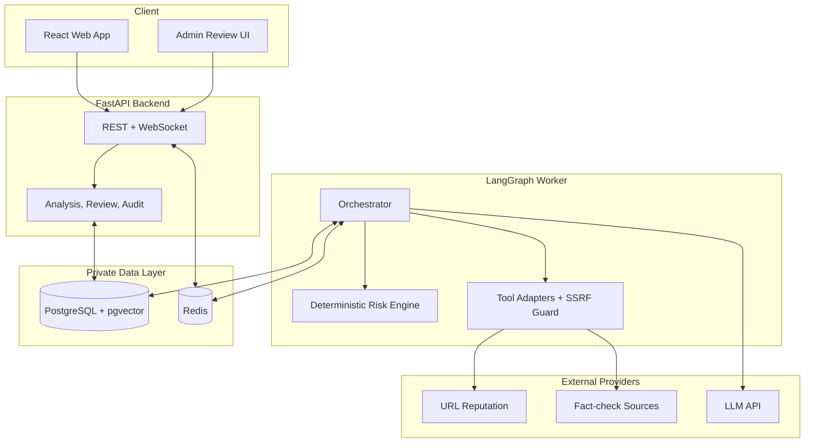
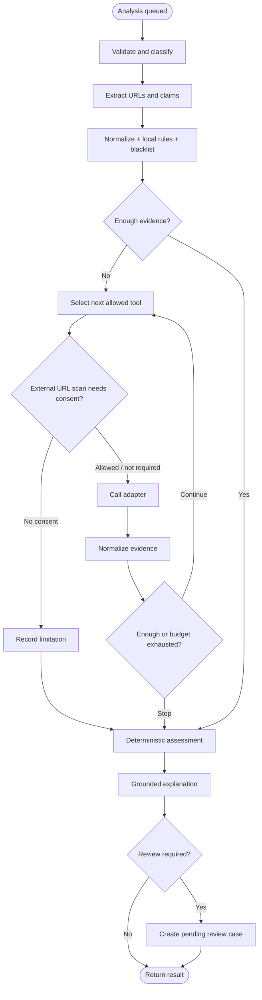
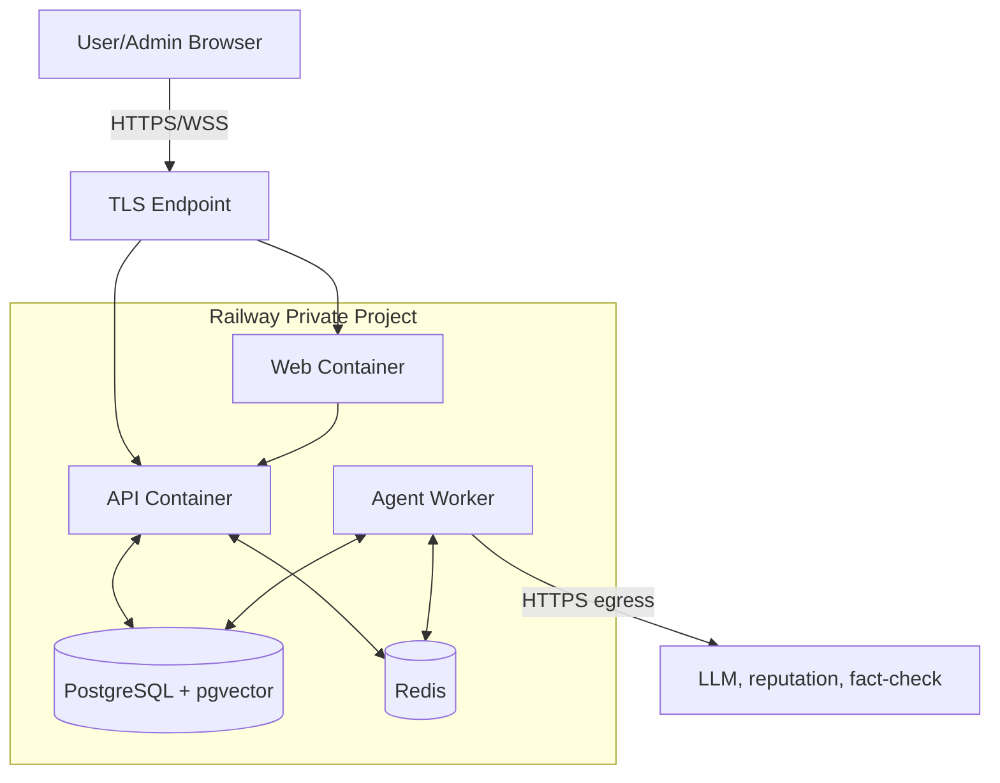

# Architecture — P-068

> Tài liệu này định nghĩa **hệ thống được tổ chức và chạy như thế nào**. Không định nghĩa lại scope sản phẩm, payload hay ownership.

## 1. System Overview



Dependency direction trong code: `api → application service → agents graph → agents.tools protocol → adapter`. Node không import provider SDK; API không biết raw provider response.

## 2. Agent Flow



Vòng lặp dừng khi evidence đủ, hết tool calls/retries, vượt time/cost budget hoặc không còn tool phù hợp. Tool lỗi được chuẩn hóa thành error/limitation; không trở thành tín hiệu an toàn.

## 3. Deployment



- Chỉ Web/API public; Worker, Redis và DB nằm trong private network.
- API enqueue job và phát status; Worker thực thi graph, persist state/evidence.
- Secrets được inject server-side. Browser không gọi trực tiếp provider.
- CI build immutable images, chạy test/migration rồi deploy; DB dùng persistent storage và backup.

## 4. Security boundaries

- URL adapter validate scheme/host, resolve DNS, chặn loopback/private/link-local/multicast/cloud-metadata trước request và sau mỗi redirect.
- Redirect count, response size, timeout, retry, rate và tool budget bị giới hạn.
- AuthN ở API; ownership/RBAC được kiểm tra trước đọc analysis hoặc admin action.
- Message chỉ đi đến thành phần cần thiết; log dùng ID/latency/status và redaction dữ liệu nhạy cảm.
- LLM chỉ nhận context tối thiểu và output có schema; Risk Engine không dùng output tự do làm điểm.
- Blacklist write chỉ nằm sau admin authorization và audit transaction.

## 5. Repository mapping

```text
src/
├── agents/         # state, graph, nodes, tool protocols, adapters and network safety
├── api/            # REST, WebSocket, auth dependencies
├── services/       # analysis/review use cases
├── repositories/   # persistence implementations
├── models/         # shared Pydantic contracts
└── core/           # config, logging, security utilities
tests/{unit,integration,contract,eval,fixtures}/
eval/{datasets,scripts}/
```

Giữ package hiện tại `src/agents` làm nơi duy nhất cho orchestration và tool boundary. Tool protocol, fake adapter, provider adapter và network safety được tách thành các module trong `src/agents/tools/`; `src/services` và `src/repositories` được thêm ở top level để tách use case và persistence khỏi agent.
