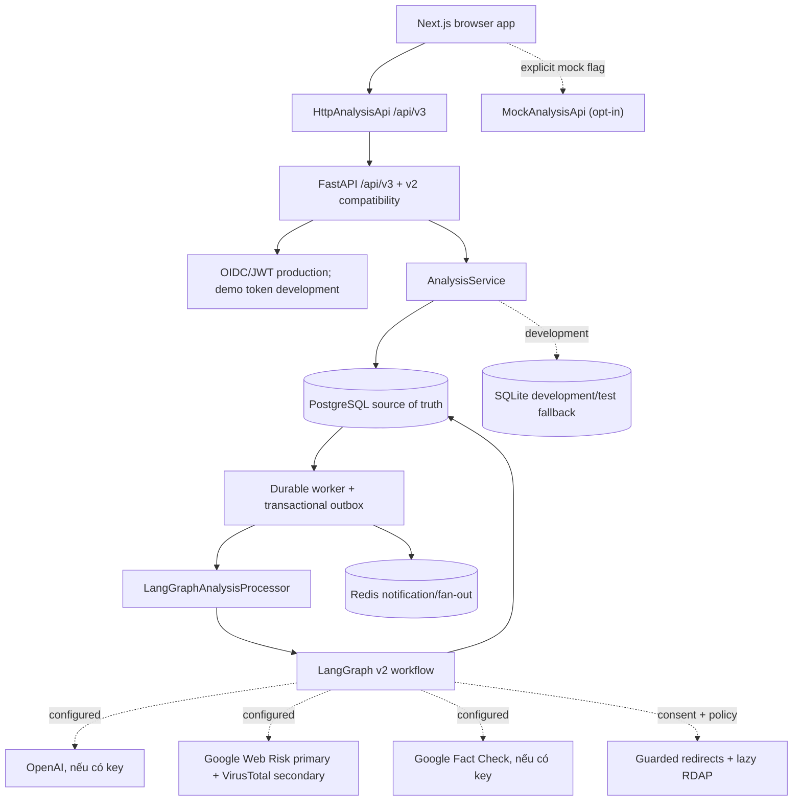
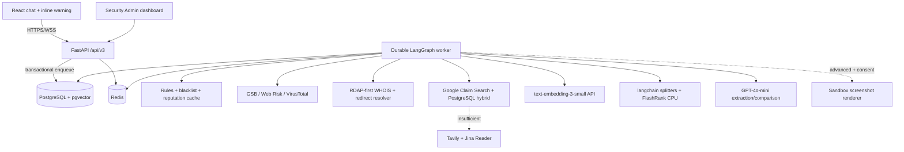
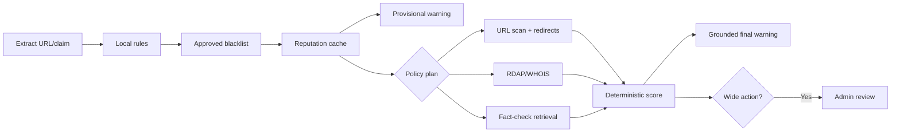
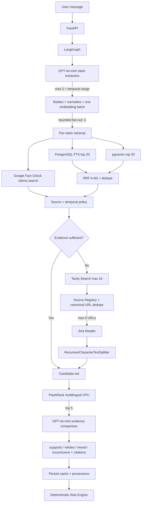

# Architecture — P-068

**Snapshot:** 2026-08-09

**Phạm vi:** Kiến trúc đang tồn tại trong repository sau Wave 1; các capability chưa hoàn tất được ghi rõ ở bảng trạng thái.

> Dependency direction chủ đạo: `api → services → agents.graph → tools protocols/adapters →
> external providers`, với `models` là contract dùng chung.

## 1. System overview hiện tại



Dashboard, history và admin pages mặc định gọi API thật. `MockAnalysisApi` chỉ chạy khi
`NEXT_PUBLIC_USE_MOCK_API=true`, phục vụ component development và fixture offline.

## 2. Request lifecycle

1. `POST /api/v3/analyses` xác thực principal, validate request và trả `202` sau khi persist analysis,
   event đầu tiên, durable job và outbox trong PostgreSQL.
2. Outbox publisher dùng Redis để thông báo; Redis không giữ authoritative state.
3. Durable worker claim job bằng lease/idempotency, gọi `LangGraphAnalysisProcessor`, rồi persist
   step/evidence và terminal result. Job hết lease có thể được claim lại sau restart.
4. Browser xin WebSocket ticket ngắn hạn, replay event theo cursor và tự chuyển sang polling fallback
   nếu stream không khả dụng. Disconnect không hủy analysis.
5. Development/test có thể dùng SQLite và in-process processor để chạy offline; đây không phải profile
   production.

## 3. Agent workflow

```mermaid
flowchart LR
    A[Classify] --> B[Extract]
    B --> C[LLM semantic]
    C --> D[Normalize + local rules + blacklist]
    D --> E[LLM tool proposal]
    E --> F[Build policy plan]
    F --> G[Bounded planning loop]
    G --> H[Deterministic risk]
    H --> I[LLM assessment review]
    I --> J[Deterministic explanation]
    J --> K[Route action/case]
    K --> L[LLM grounded response]
```



Topology trong `build_graph` là tuyến tính; conditional behavior nằm bên trong planning loop.
Planner không điều khiển trực tiếp network work. `build_investigation_plan` luôn bổ sung local
rules, blacklist và các tool cần thiết mà model bỏ sót; executable target được derive lại từ state.

Planning loop:

- dùng stable `step_id = sha256(tool + target)` rút gọn;
- chỉ chạy step có dependency đã `completed`;
- re-check consent ngay trước khi tạo coroutine cho URL scanner/RDAP;
- fan-out các step độc lập bằng `asyncio.gather` trong số tool budget còn lại;
- retry tuần tự với mặc định một retry ở workflow state;
- dùng execution ledger `(analysis_id, step_id, target, provider)` để dedupe khi SQLite repository
  được inject;
- dừng khi không còn step sẵn sàng, hết budget hoặc deadline (nếu caller truyền `deadline_at`).

Planning loop đã tạo `pending/running/completed/skipped/failed` qua `ProgressSink`, nhưng runtime factory
hiện chưa inject sink persistence. `LangGraphAnalysisProcessor` vẫn chuyển plan cuối thành step event
sau `ainvoke`; vì vậy WebSocket/polling có replay ổn định nhưng chưa phản ánh transition theo thời gian thực.

## 4. LLM boundary

LLM chỉ được tạo khi `OPENAI_API_KEY` có giá trị. Nếu không có key, bốn node LLM trở thành no-op và
workflow tiếp tục deterministic.

Các structured output nội bộ:

- `MessageAnalysis`: context, dominant emotion, sender intent, scam indicators, claims;
- `ToolPlan`: tối đa ba item trong `url_scanner|domain_intelligence|claim_retriever`;
- `AssessmentReview`: coverage, evidence indexes và missing information;
- `GroundedResponse`: summary, reasons gắn evidence index và limitations.

Wave 2 mở rộng `MessageAnalysis.claims` thành tối đa năm claim có language/temporal metadata và thêm
`ClaimAssessment` cho comparison stance/citation. Đây là private workflow state, không thêm field
vào public `AnalysisResponse`.

Invalid output/call failure được ghi vào private `llm_errors` và limitation. Public response không
chứa prompt, model trace hoặc chain-of-thought. Config runtime hiện lấy từ `Settings`; default thực
tế là model `gpt-4o-mini`, temperature `0.7`, timeout 30 giây, `max_retries=2`.

## 5. Tool và network boundary

| Capability | Implementation | Runtime mặc định |
|---|---|---|
| Local URL rules | `nodes/rules.py` | Có |
| Approved blacklist | `SQLiteBlacklistRepository` | Có ở SQLite; PostgreSQL lifecycle chưa implement |
| URL reputation | `ProductionUrlReputationCascade` (Web Risk + optional VirusTotal) | Chỉ khi có Web Risk key; fake adapters trong test |
| Indexed ClaimReview | `GoogleClaimSearch` — Google Fact Check Tools `claims.search` | Chỉ khi có API key; retrieval, không phải verifier |
| External embedding | `EmbeddingProvider` target: OpenAI `text-embedding-3-small` | Wave 2; không có local-model fallback |
| Existing corpus | `HybridCorpusRetriever` — PostgreSQL FTS + pgvector/RRF | Wave 2; Source Registry + temporal filter bắt buộc |
| Web discovery | `TavilySearch` | Chỉ sau sufficiency miss; domain filter từ Source Registry |
| Web extraction | `JinaReader` | Tối đa 5 canonical URL đã qua policy |
| Chunking/rerank | `langchain-text-splitters` + FlashRank `ms-marco-MultiBERT-L-12` | Local CPU; top 5; không sinh verdict |
| Domain intelligence | Lazy `RdapDomainIntelligence` | Inject sẵn; chỉ tạo request sau consent/policy |
| Redirect resolver | `GuardedRedirectResolver` | Inject sẵn; revalidate từng hop |
| Offline tools | Fake URL/claim/domain/blacklist adapters | Test only |

`RdapDomainIntelligence` dùng PSL đóng gói để lấy registrable domain, tải IANA DNS bootstrap qua
HTTPS, cache positive 24 giờ và not-found một giờ, bỏ qua entity/vCard và chỉ normalize field
allowlist. Timeout/429/provider error không được cache như kết quả hợp lệ.

`SsrfGuard` chỉ cho URL tuyệt đối HTTP(S), không credential, port 80/443 và yêu cầu mọi DNS answer
là global. `GuardedHttpClient` pin địa chỉ đã validate, revalidate từng redirect, giới hạn năm hop
và response body 1 MiB.

Graph v2 vẫn giữ `GoogleSafeBrowsingScanner` compatibility khi cấu hình key cũ. Product path v3 dùng
Web Risk primary, chỉ gọi VirusTotal khi policy/budget cho phép và kết quả primary cần escalation.

## 6. Persistence

Production dùng `PostgresPlatformRepository` làm source of truth cho analysis/job/event/evidence/report;
SQLite giữ vai trò development/test fallback và compatibility importer cho dữ liệu dev cũ.

PostgreSQL hiện đã persist user-report review queue và audit decision của queue. Riêng v2 admin case
decision/approved blacklist (`apply_review_decision`, blacklist lookup/list) vẫn chỉ hoàn chỉnh ở SQLite;
không được coi flow critical → blacklist là production-ready trên PostgreSQL.

Các nhóm bảng chính:

- `analyses`, `analysis_events`, `analysis_steps`, `analysis_evidence`, `analysis_errors`;
- `tool_executions`, `outbox_events`, `analysis_migration_errors`;
- `analysis_reports`, `admin_decisions`, `blacklist`, `schema_migrations`;
- `review_queue_items` — mỗi user report tạo một item liên kết với `report_id` và `analysis_id`, lưu evidence snapshot, status (`submitted` → `reviewing` → `processed`) và audit decision/reviewer/note/time.

Completed result thay thế step/evidence/error artifacts trong transaction. Admin review dùng
`apply_review_decision` để cập nhật audit, blacklist, analysis state, event và outbox nguyên tử.
Blacklist lookup join với approved `add_to_blacklist` decision; boolean vô danh không được dùng.
Decision service hiện lấy `hostname` trực tiếp từ normalized URL trước khi ghi blacklist, nên
subdomain chưa luôn được quy về eTLD+1 như RDAP target.

`DATABASE_URL` quyết định profile repository. PostgreSQL kích hoạt durable worker/outbox; Alembic phải
được chạy riêng bằng `uv run alembic upgrade head` trước khi mở API;
SQLite path lấy từ `SECURITY_DATABASE_PATH` (mặc định `./data/security.db`) cho local/offline tests.
Redis dùng cho outbox notification, shared WebSocket ticket, event fan-out và rate limit ở production.

## 7. API và security boundaries

- FastAPI expose `/api/v3` cho product flow và giữ `/api/v2` read-compatible trong migration; `/health` nằm ngoài prefix.
- Ownership được check trước get/event/report. Security Admin chỉ đọc analysis của user khác nếu
  case đã ở trạng thái reviewable.
- Admin list/decision endpoints gọi `require_security_admin`.
- CORS lấy từ `CORS_ORIGINS`; secret chỉ ở server.
- Validation và `PlatformError` dùng error envelope v2.
- Production dùng OIDC/JWT với issuer/audience cấu hình; demo authenticator chỉ được phép trong development.

Legacy `/api/v2/chat` và `/api/v2/status` vẫn tồn tại, dùng graph mẫu riêng và không thuộc analysis
contract. Không nên dùng hai endpoint này cho product flow.

## 8. Frontend hiện tại

Frontend là Next.js 16/React 19. Repository có:

- type v2/v3 đồng bộ với backend;
- `HttpAnalysisApi` cho create/get/list/report, admin list, review-queue list/start/decision;
- `MockAnalysisApi` opt-in, form consent, result/evidence/recommendation/report components và fixture tests;
- dashboard `AnalysisWorkspace` gọi API thật qua v3, dùng WebSocket ticket/reconnect/cursor/dedupe và polling fallback;
- history page lấy dữ liệu từ `GET /api/v3/analyses`;
- admin page có ba tab: Fact-check Review, URL Security và **User Reports** (hiển đầy đủ lý do, ghi chú và nội dung gốc từ review-queue API v3);
- API client nhận OIDC access token qua auth layer; demo role/token chỉ là local fallback.

`HttpAnalysisApi` là mặc định. Chỉ khi `NEXT_PUBLIC_USE_MOCK_API=true` frontend mới dùng adapter in-memory.
UI đã hỗ trợ provisional banner, nhưng runtime backend hiện chưa persist/emit `provisional_warning` từ
graph; banner này mới xuất hiện với fixture hoặc khi progress/provisional sink được wire.

## 9. Final production topology



Đây là topology production Wave 1 hiện tại. Redis chỉ làm broker, cache và event fan-out;
PostgreSQL là source of truth. Các phần pgvector corpus, screenshot renderer và campaign/appeal đầy đủ
vẫn thuộc wave tiếp theo.
`pgvector` phục vụ fact-check corpus, không phải dependency của deterministic URL scoring.

Frontend dùng `/api/v3`; `/api/v2` được giữ read-compatible trong migration. Legacy `/chat`/`status`
không thuộc product flow.

### 9.1 Agent flow đích và cảnh báo hai pha



Provisional warning chỉ phản ánh evidence local/cache và phải có nhãn `đang xác minh`; final warning
thay thế nó sau khi workflow hoàn tất. Mục tiêu p95 là 1 giây cho provisional và 10 giây cho final
khi provider bình thường. WebSocket truyền cùng schema event với polling fallback; disconnect không
hủy analysis và reconnect phải đọc lại event đã persist.

Wave 0 tách bốn injectable boundary tại `src/agents/seams.py`: `ProgressSink`, `RiskEngine`,
`ExplanationEngine` và `CampaignDetector`. Default risk/explanation chỉ bọc deterministic v2
functions; default campaign detector và progress persistence là no-op. Planning loop đã phát typed
transition qua sink boundary, còn durable persistence/replay thuộc Wave 1. Campaign detector chỉ có
thể trả admin hypothesis với approval flags fail-closed; clustering thật thuộc Wave 2.

### 9.2 Provider, budget và cost routing

- `UrlScanner` là protocol chung cho Google Safe Browsing/Web Risk hoặc VirusTotal. Provider no-hit
  luôn normalize thành `inconclusive`; cache key gồm provider/version/normalized target.
- RDAP là nguồn WHOIS mặc định và chỉ giữ public allowlisted fields. Redirect resolver revalidate
  DNS/URL từng hop. Không dùng WHOIS TCP hoặc lưu registrant entity.
- Rule, approved blacklist và cache chạy trước. External adapters độc lập fan-out sau consent;
  `gpt-4o-mini` chỉ chạy khi cần ngữ cảnh/grounded explanation.
- Mỗi analysis có deadline, tool-call/token/cost budget, retry cap và circuit/rate-limit handling.
  Usage metadata lưu theo provider mà không lưu raw private input.
- Screenshot renderer là advanced fallback: sandbox không cookie, credential, login hay persistent
  storage; chặn script/download khi policy yêu cầu và áp dụng SSRF, hop, size, time budget.

### 9.3 Fact-check: retrieve first, search web only when needed

`gpt-4o-mini` dùng Structured Outputs để extract tối đa năm claim và so sánh evidence;
`text-embedding-3-small` tạo một embeddings batch cho semantic retrieval. FlashRank là ngoại lệ local:
reranker CPU chỉ sắp hạng candidate, không xác minh claim và không ghi risk score. Tham chiếu:
[GPT-4o mini](https://developers.openai.com/api/docs/models/gpt-4o-mini),
[text-embedding-3-small](https://developers.openai.com/api/docs/models/text-embedding-3-small).



#### Google retrieval semantics và corpus hybrid

Google Fact Check Tools `claims.search` chỉ tìm các claim đã được fact-check và trả claim cùng
`ClaimReview` liên quan; đây là retrieval/index layer, không phải Google tự xác minh hay cung cấp một
“Google verdict”. Publisher/reviewer gốc quyết định provenance và source tier. Xem
[Google Fact Check Tools API](https://developers.google.com/fact-check/tools/api/reference/rest/v1alpha1/claims/search).

Mỗi `ExtractedClaim` gồm `claim_id`, text chuẩn hóa, language, `is_temporal`, `claim_date_start` và
`claim_date_end`; từ “hiện nay/hôm nay” neo vào `analysis.created_at`. Toàn bộ claim được embed một
lần, rồi tối đa ba claim chạy song song. Với mỗi claim, Google Claim Search và Existing Corpus chạy
song song. Corpus lấy top 20 từ FTS cấu hình `simple` và top 20 từ pgvector cosine, lọc đúng
model/version/dimensions, source active và temporal eligibility, dedupe theo record/version rồi hợp
nhất bằng reciprocal-rank fusion `k=60`. Embedding timeout/429 chỉ bỏ nhánh vector; Google và FTS vẫn
chạy, không load embedding model local.

#### Source Trust Policy và temporal eligibility

Source Registry là policy versioned, audited, có origin/pattern, tier, source type, active,
allowed operations, effective interval và reviewer. `*.gov.vn` mặc định Tier A theo suffix match
đúng ranh giới hostname; explicit deny/disable luôn thắng. Policy:

| Tier | Nguồn | Quyền dùng |
|---|---|---|
| A | `*.gov.vn` | Có thể hỗ trợ kết luận nếu temporal-compatible |
| B | Approved newspapers, trusted fact-checkers | Có thể hỗ trợ kết luận |
| C | Other reputable sources | Chỉ corroboration, không bao giờ đủ một mình |
| Untrusted | Unknown blogs, forums, social media | Discovery only; loại trước comparator |

Evidence đủ khi có **một Tier A temporal-compatible**, **một trusted ClaimReview Tier B**, hoặc
**hai Tier B độc lập**. Independence tính theo publisher/organization, không theo URL. Tier C không
thể làm gate thành công.

Temporal claim bắt buộc xét `claim_date_start/end`, `published_at`, `effective_from/to` và
`retrieved_at`. Effective interval phủ claim date là tín hiệu mạnh nhất. Nếu nguồn không công bố
effective interval, `updated_at`/`published_at` được dùng làm proxy với penalty và limitation; nếu
không có bất kỳ ngày nào thì loại khỏi temporal comparison. Semantic relevance không được override
temporal incompatibility.

#### Conditional web retrieval, chunking và rerank

Chỉ evidence-sufficiency miss mới gọi Tavily, giúp giảm cost/latency/token và phụ thuộc external API.
Request dùng `max_results=10`, không lấy generated answer/raw content, truyền `include_domains` từ
Source Registry; temporal query dùng news/date range tương ứng. Sau policy check và canonical URL
dedupe, tối đa năm URL đi qua Jina Reader để lấy cleaned text/Markdown. Xem
[Tavily Search](https://docs.tavily.com/documentation/api-reference/endpoint/search) và
[Jina Reader](https://jina.ai/reader/).

`RecursiveCharacterTextSplitter` dùng `chunk_size=1200`, `chunk_overlap=150` và separator ưu tiên
paragraph/sentence; mỗi chunk giữ source/version/date/content hash. FlashRank singleton chạy CPU với
`ms-marco-MultiBERT-L-12`, `max_length=512`, chọn top 5 trên toàn bộ candidate. Model phải được bundle
hoặc cache trong image, không download lúc request. Xem
[LangChain text splitters](https://docs.langchain.com/oss/python/integrations/splitters/recursive_text_splitter)
và [FlashRank](https://github.com/PrithivirajDamodaran/FlashRank).

Comparator chỉ nhận top 5 evidence đủ policy, trả `supports | refutes | mixed | inconclusive`, opaque
citation refs, contradiction refs và limitations; citation ngoài input/sai schema/timeout thành
`inconclusive`. Evidence web mới được canonicalize, dedupe theo URL + cleaned-content hash + source
version rồi cache ngay. Chỉ Tier A/B đã validate/review mới được promote vào trusted corpus; Tier C
không auto-promote. Runtime stance không bao giờ tự trở thành trusted record. Các boundary nội bộ là
`GoogleClaimSearch`, `HybridCorpusRetriever`, `EvidenceSufficiencyGate`, `TavilySearch`, `JinaReader`,
`Chunker`, `Reranker`, `SourceRegistry` và `EvidenceComparator`.

### 9.4 Campaign và feedback

Campaign detection gom cụm theo registrable domain, redirect target, claim embedding và time window,
chỉ tạo hypothesis cho admin. Không lưu/suy diễn social graph hay danh tính sender. User report và
appeal đi vào review/evaluation set; mọi thay đổi rule/threshold/model được version, đánh giá offline
và phê duyệt, không online-learn trực tiếp.

### 9.5 Privacy và approval boundaries

- Client/user chủ động chọn nội dung; backend không đọc history nền hoặc phá E2E encryption.
- URL/domain lookup và screenshot cần consent. LLM/fact-check chỉ nhận claim/đoạn trích tối thiểu đã
  redact; logs không chứa raw message, OTP, secret hay raw provider body.
- Individual warning có thể tự động. `add_to_blacklist`, `block_domain` và
  `publish_broad_warning` cần Security Admin review, evidence snapshot, note và audit transaction.
- Appeal có thể đảo quyết định/disable blacklist qua một quyết định mới; không xóa audit cũ.

### 9.6 Capability status

| Capability | Hiện tại | Đích |
|---|---|---|
| UI/API | Browser product flow trên `/api/v3`; v2 compatibility | Hoàn thiện các endpoint v3 còn `501` |
| Progress | WebSocket + polling replay; step event hiện được tạo sau graph, chưa live trong planning loop | Wire progress/provisional sink và thêm observability/SLO |
| Persistence | PostgreSQL production; SQLite dev/test | pgvector cho fact-check corpus |
| Jobs | Durable worker/outbox, lease/retry/idempotency | Mở rộng chaos/recovery tests |
| URL reputation | Web Risk primary, VirusTotal policy-gated secondary; fake default test | Provider operations hardening |
| Domain/redirect | Lazy RDAP sau consent + guarded redirect resolver | Mở rộng provider coverage |
| Fact-check | Google Claim Search adapter + normalized corpus boundary | Google + FTS/pgvector → sufficiency gate → conditional Tavily/Jina → FlashRank → comparison/cache |
| Screenshot | Chưa có | Sandboxed renderer trong final release |
| Feedback | User report queue + audited queue decision trên SQLite/PostgreSQL; blacklist decision chỉ SQLite | PostgreSQL blacklist lifecycle, appeal, calibrated learning, campaign dashboard |
| Deploy | Compose/PostgreSQL/Redis/Alembic path đã có | Hosted rollout với health, migration và secrets |

## 10. Repository map

```text
src/
├── agents/          # state, graph, nodes, tool protocols/adapters
├── api/             # v2 routes, frozen v3 contract routes và dependency wiring
├── services/        # application service + graph processor
├── repositories/    # SQLite fallback, PostgreSQL production core và fact-check corpus
├── models/          # strict, separately versioned Pydantic v2/v3 contracts
├── core/            # auth và platform errors
└── main.py          # FastAPI app
frontend/src/        # Next.js UI, API clients, shared TS contract
tests/               # agent, API, unit, contract và fixture tests
```
