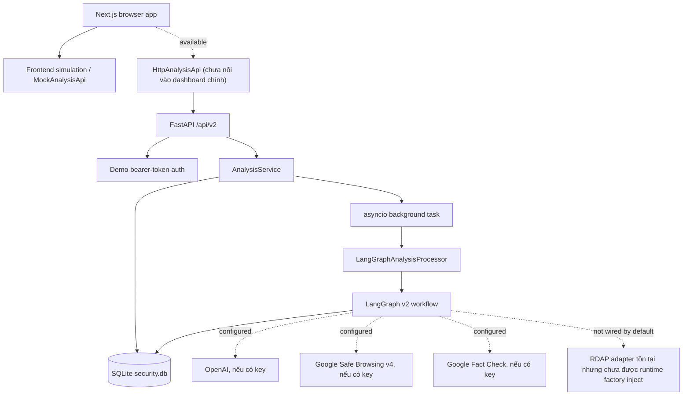
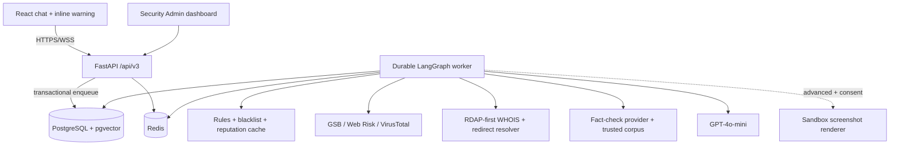
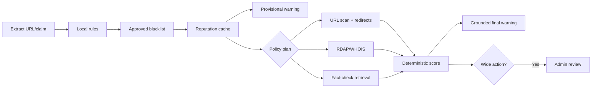

# Architecture — P-068

**Snapshot:** 2026-08-07

**Phạm vi:** Kiến trúc đang tồn tại trong repository; topology đích được ghi riêng ở phần 9

> Dependency direction chủ đạo: `api → services → agents.graph → tools protocols/adapters →
> external providers`, với `models` là contract dùng chung.

## 1. System overview hiện tại



Dashboard, history và admin pages hiện vẫn dùng dữ liệu mô phỏng/hard-coded. Vì vậy code có một
backend vertical slice hoạt động và một frontend UI hoạt động riêng, nhưng chưa có web vertical
slice end-to-end.

## 2. Request lifecycle

1. `POST /api/v2/analyses` xác thực demo bearer token và validate `AnalysisCreateRequest`.
2. `AnalysisService.create` tạo record/event `queued`, persist vào SQLite nếu repository hỗ trợ,
   rồi trả `202` ngay.
3. Service tạo `asyncio.Task` trong process. Task đổi record thành `running`, gọi
   `LangGraphAnalysisProcessor`, sau đó persist completed response hoặc trạng thái `failed`.
4. Client đọc state bằng `GET /api/v2/analyses/{id}` và đọc event bằng endpoint `/events`.
5. Restart process không khôi phục task đang chạy. Outbox và execution ledger đã có schema/boundary
   nhưng chưa có publisher/worker tiêu thụ durable job.

Task background được giữ trong `AnalysisService._tasks` và bị cancel khi ứng dụng đóng. Đây là cơ
chế vertical slice, không phải queue production-grade.

## 3. Agent workflow

```mermaid
flowchart LR
    A[Classify] --> B[Extract]
    B --> C[LLM semantic]
    C --> D[Normalize + local rules + blacklist]
    D --> E[LLM tool proposal]
    E --> F[Build policy plan]
    F --> G[Bounded planning loop]
    G --> H[Deterministic risk]
    H --> I[LLM assessment review]
    I --> J[Deterministic explanation]
    J --> K[Route action/case]
    K --> L[LLM grounded response]
```



Topology trong `build_graph` là tuyến tính; conditional behavior nằm bên trong planning loop.
Planner không điều khiển trực tiếp network work. `build_investigation_plan` luôn bổ sung local
rules, blacklist và các tool cần thiết mà model bỏ sót; executable target được derive lại từ state.

Planning loop:

- dùng stable `step_id = sha256(tool + target)` rút gọn;
- chỉ chạy step có dependency đã `completed`;
- re-check consent ngay trước khi tạo coroutine cho URL scanner/RDAP;
- fan-out các step độc lập bằng `asyncio.gather` trong số tool budget còn lại;
- retry tuần tự với mặc định một retry ở workflow state;
- dùng execution ledger `(analysis_id, step_id, target, provider)` để dedupe khi SQLite repository
  được inject;
- dừng khi không còn step sẵn sàng, hết budget hoặc deadline (nếu caller truyền `deadline_at`).

Hiện `LangGraphAnalysisProcessor` chỉ gọi progress callback sau `ainvoke`, bằng cách duyệt plan cuối.
Do đó event có `step_id/step_status` nhưng chưa phản ánh transition theo thời gian thực.

## 4. LLM boundary

LLM chỉ được tạo khi `OPENAI_API_KEY` có giá trị. Nếu không có key, bốn node LLM trở thành no-op và
workflow tiếp tục deterministic.

Các structured output nội bộ:

- `MessageAnalysis`: context, dominant emotion, sender intent, scam indicators, claims;
- `ToolPlan`: tối đa ba item trong `url_scanner|domain_intelligence|claim_retriever`;
- `AssessmentReview`: coverage, evidence indexes và missing information;
- `GroundedResponse`: summary, reasons gắn evidence index và limitations.

Invalid output/call failure được ghi vào private `llm_errors` và limitation. Public response không
chứa prompt, model trace hoặc chain-of-thought. Config runtime hiện lấy từ `Settings`; default thực
tế là model `gpt-4o-mini`, temperature `0.7`, timeout 30 giây, `max_retries=2`.

## 5. Tool và network boundary

| Capability | Implementation | Runtime mặc định |
|---|---|---|
| Local URL rules | `nodes/rules.py` | Có |
| Approved blacklist | `SQLiteBlacklistRepository` | Có |
| URL reputation | `GoogleSafeBrowsingScanner` v4 | Chỉ khi có API key |
| Fact-check | `GoogleFactCheckRetriever` | Chỉ khi có API key |
| Domain intelligence | `RdapDomainIntelligence` | **Chưa inject** trong `build_provider_adapters` |
| Redirect resolver | Protocol + `GuardedHttpClient` primitive | Chưa có adapter/node wiring |
| Offline tools | Fake URL/claim/domain/blacklist adapters | Test only |

`RdapDomainIntelligence` dùng PSL đóng gói để lấy registrable domain, tải IANA DNS bootstrap qua
HTTPS, cache positive 24 giờ và not-found một giờ, bỏ qua entity/vCard và chỉ normalize field
allowlist. Timeout/429/provider error không được cache như kết quả hợp lệ.

`SsrfGuard` chỉ cho URL tuyệt đối HTTP(S), không credential, port 80/443 và yêu cầu mọi DNS answer
là global. `GuardedHttpClient` pin địa chỉ đã validate, revalidate từng redirect, giới hạn năm hop
và response body 1 MiB.

Lưu ý hiện trạng: Safe Browsing adapter gọi `SsrfGuard.validate(normalized_url)` trước khi gửi URL
tới endpoint cố định. Adapter v4 là compatibility code; chưa có v5/Web Risk implementation.

## 6. Persistence

`SQLiteBlacklistRepository` hiện đóng nhiều vai trò: analysis repository, event/artifact store,
tool execution ledger, report/decision store và approved blacklist.

Các nhóm bảng chính:

- `analyses`, `analysis_events`, `analysis_steps`, `analysis_evidence`, `analysis_errors`;
- `tool_executions`, `outbox_events`, `analysis_migration_errors`;
- `analysis_reports`, `admin_decisions`, `blacklist`, `schema_migrations`.

Completed result thay thế step/evidence/error artifacts trong transaction. Admin review dùng
`apply_review_decision` để cập nhật audit, blacklist, analysis state, event và outbox nguyên tử.
Blacklist lookup join với approved `add_to_blacklist` decision; boolean vô danh không được dùng.
Decision service hiện lấy `hostname` trực tiếp từ normalized URL trước khi ghi blacklist, nên
subdomain chưa luôn được quy về eTLD+1 như RDAP target.

SQLite path thực tế lấy từ `SECURITY_DATABASE_PATH` (mặc định `./data/security.db`). `DATABASE_URL`
và `REDIS_URL` có trong Settings/Compose nhưng chưa được application runtime sử dụng. PostgreSQL và
Redis containers hiện không phải nguồn dữ liệu của backend.

## 7. API và security boundaries

- FastAPI mount toàn bộ router ở `/api/v2`; `/health` nằm ngoài prefix.
- Ownership được check trước get/event/report. Security Admin chỉ đọc analysis của user khác nếu
  case đã ở trạng thái reviewable.
- Admin list/decision endpoints gọi `require_security_admin`.
- CORS lấy từ `CORS_ORIGINS`; secret chỉ ở server.
- Validation và `PlatformError` dùng error envelope v2.
- Demo authenticator map hai bearer token tĩnh thành `demo-user` và `demo-security-admin`.

Legacy `/api/v2/chat` và `/api/v2/status` vẫn tồn tại, dùng graph mẫu riêng và không thuộc analysis
contract. Không nên dùng hai endpoint này cho product flow.

## 8. Frontend hiện tại

Frontend là Next.js 16/React 19. Repository có:

- type v2 đồng bộ với backend;
- `HttpAnalysisApi` cho create/get/list/report và admin list;
- `MockAnalysisApi`, form consent, result/evidence/recommendation/report components và polling-style
  tests;
- dashboard `AnalysisWorkspace` cũ tự chạy timer sáu giây và tự sinh verdict;
- history/admin pages dùng mảng hard-coded; admin buttons chưa gọi API decision;
- auth context và login chỉ lưu mock role trong local storage.

`NEXT_PUBLIC_USE_MOCK_API` mặc định chọn mock trừ khi đặt chính xác `false`, nhưng dashboard chính
hiện không gọi cả mock lẫn HTTP abstraction.

## 9. Final production topology



Đây là topology bắt buộc của final release, được triển khai theo merge waves sau khi dashboard/admin
dùng API thật, progress transition được stream trong graph và recovery test cho job/outbox/
idempotency xanh. Redis chỉ làm broker, cache và event fan-out; PostgreSQL là source of truth.
`pgvector` phục vụ fact-check corpus, không phải dependency của deterministic URL scoring.

`/api/v2` vẫn mô tả runtime hiện tại ở các phần 1–8. Final frontend dùng `/api/v3`; release v3 đầu
tiên giữ v2 read-compatible và loại legacy `/chat`/`status` khỏi production surface.

### 9.1 Agent flow đích và cảnh báo hai pha



Provisional warning chỉ phản ánh evidence local/cache và phải có nhãn `đang xác minh`; final warning
thay thế nó sau khi workflow hoàn tất. Mục tiêu p95 là 1 giây cho provisional và 10 giây cho final
khi provider bình thường. WebSocket truyền cùng schema event với polling fallback; disconnect không
hủy analysis và reconnect phải đọc lại event đã persist.

### 9.2 Provider, budget và cost routing

- `UrlScanner` là protocol chung cho Google Safe Browsing/Web Risk hoặc VirusTotal. Provider no-hit
  luôn normalize thành `inconclusive`; cache key gồm provider/version/normalized target.
- RDAP là nguồn WHOIS mặc định và chỉ giữ public allowlisted fields. Redirect resolver revalidate
  DNS/URL từng hop. Không dùng WHOIS TCP hoặc lưu registrant entity.
- Rule, approved blacklist và cache chạy trước. External adapters độc lập fan-out sau consent;
  `gpt-4o-mini` chỉ chạy khi cần ngữ cảnh/grounded explanation.
- Mỗi analysis có deadline, tool-call/token/cost budget, retry cap và circuit/rate-limit handling.
  Usage metadata lưu theo provider mà không lưu raw private input.
- Screenshot renderer là advanced fallback: sandbox không cookie, credential, login hay persistent
  storage; chặn script/download khi policy yêu cầu và áp dụng SSRF, hop, size, time budget.

### 9.3 Fact-check, campaign và feedback

Fact-check provider là đường cơ bản. Pha nâng cao ingest nguồn đã phê duyệt vào PostgreSQL/pgvector,
lưu source URL, publisher, publication/update time, language, claim, stance và embedding version.
Retrieval phải lọc nguồn hợp lệ và trả citation; similarity một mình không được coi là verdict.

Campaign detection gom cụm theo registrable domain, redirect target, claim embedding và time window,
chỉ tạo hypothesis cho admin. Không lưu/suy diễn social graph hay danh tính sender. User report và
appeal đi vào review/evaluation set; mọi thay đổi rule/threshold/model được version, đánh giá offline
và phê duyệt, không online-learn trực tiếp.

### 9.4 Privacy và approval boundaries

- Client/user chủ động chọn nội dung; backend không đọc history nền hoặc phá E2E encryption.
- URL/domain lookup và screenshot cần consent. LLM/fact-check chỉ nhận claim/đoạn trích tối thiểu đã
  redact; logs không chứa raw message, OTP, secret hay raw provider body.
- Individual warning có thể tự động. `add_to_blacklist`, `block_domain` và
  `publish_broad_warning` cần Security Admin review, evidence snapshot, note và audit transaction.
- Appeal có thể đảo quyết định/disable blacklist qua một quyết định mới; không xóa audit cũ.

### 9.5 Capability status

| Capability | Hiện tại | Đích |
|---|---|---|
| UI/API | UI simulation + backend v2 riêng | Browser final product trên `/api/v3`; v2 read-compatible |
| Progress | Polling endpoint, event timing chưa live | WebSocket + polling replay |
| Persistence | SQLite | PostgreSQL; pgvector cho fact-check corpus |
| Jobs | In-process `asyncio.Task` | Durable worker/outbox recovery |
| URL reputation | Google Safe Browsing v4 optional | Supported GSB/Web Risk hoặc VirusTotal adapter |
| Domain/redirect | RDAP adapter chưa wire; resolver chưa chạy | RDAP-first WHOIS + guarded redirects |
| Screenshot | Chưa có | Sandboxed renderer trong final release |
| Feedback | Report + admin decision | Appeal, calibrated learning, campaign dashboard trong final release |
| Deploy | Docker Compose topology lệch runtime | Docker/Railway với health, migration và secrets |

## 10. Repository map

```text
src/
├── agents/          # state, graph, nodes, tool protocols/adapters
├── api/             # v2 routes và dependency wiring
├── services/        # application service + graph processor
├── repositories/    # SQLite persistence và fact-check corpus
├── models/          # strict Pydantic v2 contract
├── core/            # auth và platform errors
└── main.py          # FastAPI app
frontend/src/        # Next.js UI, API clients, shared TS contract
tests/               # agent, API, unit, contract và fixture tests
```
