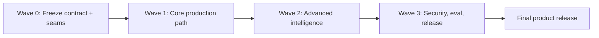

# Final Product Implementation Plan — P-068

**Revision:** 2026-08-11

**Baseline hiện tại:** working baseline ngày 2026-08-11, phát triển từ `7715ea0`

**Mục tiêu:** bốn thành viên, mỗi người dùng một coding agent, triển khai song song toàn bộ TrustGuard
AI production-ready từ baseline hiện tại. Wave 0–2 đã được merge vào baseline; kế hoạch này giờ dùng
đã đóng integration gate Wave 2 và tiếp tục hardening/release Wave 3. Không có mốc dừng ở MVP; mọi
capability Core product và Advanced intelligence trong PRD đều nằm trong Definition of Done cuối.

> Product path đang chạy là contract `/api/v3`; `/api/v2` được giữ compatibility. Contract v3 cho
> realtime, appeal, campaign, reviewed action, screenshot và operations đã có Pydantic/OpenAPI cùng
> TypeScript mirror.

## 1. Baseline không làm lại

### Đã có trong baseline `7715ea0`

- LangGraph workflow với provisional node, bounded planning, deterministic risk/explanation, Wave 2
  fact-check orchestration seam, campaign/calibration implementation và deterministic fallback.
- Consent/SSRF gate, redirect + RDAP, Web Risk/VirusTotal cascade, Google Claim Search, OpenAI
  embedding, Tavily/Jina, FlashRank và sandbox screenshot implementations.
- PostgreSQL/pgvector schema qua migration `0007_runtime_integration`, durable job/lease/retry,
  transactional outbox, Redis notification, retention và re-embedding worker.
- FastAPI `/api/v3` analysis/events/WebSocket cùng appeal, reviewed action, campaign, metrics,
  screenshot artifact và review queue; `/api/v2` compatibility vẫn còn.
- OIDC/JWT backend, production demo-auth guard, RBAC/rate limit, SQLite development fallback.
- Next.js dùng HTTP v3 mặc định; history, appeal, screenshot và platform-admin UI đã có, mock chỉ
  opt-in cho component/fixture development.

### Integration đã hoàn tất trong baseline hiện tại

- Default graph factory inject PostgreSQL hybrid retriever, chunker, preloaded FlashRank, evidence
  comparator và repository-backed campaign detector.
- Progress/provisional sink persist typed event trực tiếp trong planning loop; WebSocket và polling
  replay cùng event sequence.
- API và durable worker được tách process; Compose chạy API/worker/frontend/PostgreSQL/Redis và
  migration `0007_runtime_integration`.
- Campaign tái sử dụng claim embedding, persist observation/vector/hypothesis; admin review campaign
  và quản lý reviewed Source Registry qua API/UI.
- Screenshot signed artifact path đọc/checksum một lần và có retention worker; sandbox/egress test
  hosted vẫn là release evidence.

### Khoảng trống release còn lại
- Frontend login biết redirect tới OIDC nhưng callback/session lifecycle và hosted Auth0 flow chưa có
  release evidence; demo login vẫn tồn tại khi demo env được cấu hình.
- Railway rollout, provider live smoke, SLO/load/chaos/security/a11y matrix, backup/restore và runbook
  vẫn thuộc Wave 3. PostgreSQL integration tests cần `TEST_DATABASE_URL` nên bị skip ở offline CI.

### Trạng thái delivery tại baseline

| Wave | Trạng thái | Ý nghĩa |
|---|---|---|
| Wave 0 | Merged | Contract v3, seams và fixtures đã có |
| Wave 1 | Hoàn tất integration | Durable platform, browser path và live in-loop progress đã có |
| Wave 2 | Hoàn tất integration | Advanced runtime, campaign/source admin và Compose topology đã wire |
| Wave 3 | Chưa thực hiện | Hardening, hosted deployment, eval và release evidence |

## 2. Mô hình làm việc với 4 coding agents

Mỗi người tạo branch/worktree riêng từ cùng baseline và chỉ giao agent phạm vi đã sở hữu. Merge vào
`integration/final-product` theo từng wave; không merge trực tiếp các feature độc lập vào `main`.

Branches cố định: `work/binh-agent-risk`, `work/duc-tools-data`, `work/hai-api-platform` và
`work/hieu-frontend-qa`. Mỗi wave bắt đầu bằng rebase lên head mới nhất của
`integration/final-product`; không reuse commit chưa merge từ wave trước bằng copy thủ công.

| Người / coding agent | Sở hữu chính | Shared hotspot được quyền merge |
|---|---|---|
| Bình — Agent/Risk | `src/agents/**`, scoring/campaign logic, agent tests | `state.py`, `graph.py`, agent-node contracts |
| Đức — Tools/Data | `src/agents/tools/**`, provider adapters, corpus/fixtures | tool protocols, provider models, ingestion jobs |
| Hải — API/Platform | `src/api/**`, `src/services/**`, repositories, migrations, deploy | Python public schemas, API versioning, auth/config |
| Hiếu — Frontend/QA | `frontend/**`, browser E2E, eval/reporting | TypeScript contract mirror, UI routes/components |

Quy tắc chống conflict:

1. Hải là owner duy nhất merge thay đổi `src/models/schemas.py`; Hiếu mirror contract sang TypeScript
   từ JSON/OpenAPI đã freeze, không tự đổi enum/payload.
2. Đức sở hữu tool protocol/adapters; Bình tiêu thụ protocol, không gọi provider SDK trực tiếp.
3. Bình sở hữu AgentState/risk semantics; Hải map state sang persistence/API, không tính lại score.
4. Hiếu không mock product flow sau Wave 1; mock chỉ còn cho isolated component tests.
5. Mọi agent phải rebase trên integration head đầu mỗi wave, chạy test phạm vi mình và ghi handoff:
   files changed, migration/contract impact, commands đã chạy, limitation còn lại.
6. PR chạm consent, SSRF, auth, blacklist hoặc broad action cần reviewer từ một owner khác.

## 3. Dependency graph và merge waves

Các agent làm song song bên trong một wave. Chỉ mở wave kế tiếp khi integration gate của wave trước
xanh; không cần chờ theo lịch tuần.

## 4. Wave 0 — Freeze contract và integration seams

Mục tiêu: khóa interface để bốn agent code độc lập mà không sửa chồng nhau.

### Bình — Agent/Risk

- Chốt `WorkflowState`/node output cho `provisional_warning`, live step transition, usage refs và
  campaign features; public output không chứa chain-of-thought.
- Tách progress sink, risk engine, explanation và campaign detector thành boundary testable.
- Định nghĩa invariant: LLM không sửa score/verdict/action; provider no-hit/timeout không thành safe.

### Đức — Tools/Data

- Freeze protocols cho URL reputation cascade, redirect, RDAP, fact-check corpus và screenshot.
- Chốt normalized result/error/cache/usage metadata dùng chung; không trả raw provider body.
- Tạo offline fixtures cho consent/no-consent, redirect, RDAP, provider conflict/429 và screenshot
  security cases.

### Hải — API/Platform

- Promote phần proposed trong contract docs thành `/api/v3`; giữ `/api/v2` read-compatible trong lúc
  migration, không thêm breaking field ngầm vào v2.
- Freeze Pydantic/OpenAPI cho analysis/events, short-lived WebSocket ticket, appeal, admin action,
  campaign và operations metrics.
- Chốt PostgreSQL schema/Alembic plan: analyses, events, steps, evidence, jobs/outbox, tool usage,
  appeals, decisions, blacklist lifecycle, fact-check corpus và campaign clusters.

### Hiếu — Frontend/QA

- Generate/mirror TypeScript v3 types và `AnalysisApi` interface từ frozen OpenAPI.
- Chốt UI state machine: idle → queued → provisional → investigating → final/failed; reconnect và
  polling fallback là explicit states.
- Tạo E2E fixture harness cho user/admin và accessibility test skeleton.

### Merge gate Wave 0

- Merge order: Hải contract/schema → Đức protocols → Bình state/seams → Hiếu TypeScript mirror.
- Python/TypeScript enum, nullable field và event discriminator contract tests xanh.
- Không feature branch nào còn tự định nghĩa payload trùng hoặc import adapter cụ thể qua layer.

## 5. Wave 1 — Core production path end-to-end

Mục tiêu: thay toàn bộ demo runtime bằng đường production có thể restart/recover.

### Bình — Agent/Risk

- Emit live `pending/running/completed/skipped/failed` ngay trong planning loop.
- Sinh provisional warning chỉ từ local rule, approved blacklist và valid reputation cache; final
  result thay thế provisional, không để hai kết luận cùng active.
- Hoàn thiện redirect/domain/fact-check routing, deadline, retry, tool/token/cost budget và grounded
  explanation; giữ deterministic fallback.
- Test concurrent tools, idempotent resume, duplicate job và LLM schema/timeout failure.

### Đức — Tools/Data

- Wire RDAP lazy sau consent; implement guarded redirect resolver và shared eTLD+1 canonicalizer.
- Dùng Google Web Risk làm primary production reputation; VirusTotal là secondary cho high-risk/
  conflicting case khi policy và budget cho phép. Fake adapters vẫn là default test path.
- Implement provider-versioned cache, no-hit=`inconclusive`, 429/circuit-breaker/backoff và normalized
  usage record.
- Mở rộng fixture matrix: claim-only, subdomain/public suffix/IP literal, memory hit, redaction,
  redirect loop/private hop và provider disagreement.

### Hải — API/Platform

- Implement PostgreSQL repositories + Alembic; migration importer từ SQLite cho dữ liệu dev hiện có.
- Dùng transactional outbox + Redis durable worker; job claim/lease/retry/idempotency và restart
  recovery. Redis không là source of truth.
- Implement v3 REST, persisted event stream, short-lived WebSocket ticket và replay theo cursor;
  disconnect không hủy analysis.
- Tích hợp OIDC/JWT với configurable issuer/audience; hosted default dùng Auth0. Tắt demo auth trong
  production, thêm per-user/admin rate limit và redacted structured logs.

### Hiếu — Frontend/QA

- Thay dashboard simulation bằng API thật; hiển thị consent disclosure, provisional banner, live
  plan, final result, limitations và report.
- Thay history/admin hard-coded data bằng REST; admin review có evidence snapshot, note, double-submit
  protection và conflict state.
- Implement WebSocket reconnect/cursor/dedupe, polling fallback và URL rendering không clickable.
- E2E: login → analyze → provisional → final → history; critical → admin approval → blacklist hit.

### Merge gate Wave 1

- Merge order: Đức adapters + Hải persistence/API có thể song song; Bình graph sau protocol/schema;
  Hiếu UI sau endpoint integration tests.
- Browser flow thật không còn mock/hard-coded product data.
- Restart API/worker giữa analysis không mất hoặc nhân đôi job/event/evidence.
- No-consent test chứng minh không tạo external provider client/request.
- Provisional p95 ≤ 1 giây với local/cache; final p95 ≤ 10 giây với controlled normal providers.

## 6. Wave 2 — Toàn bộ tính năng nâng cao

Mục tiêu: hoàn thành fact-check corpus, screenshot, campaign, appeal và operations dashboard; không
để chúng ở trạng thái “roadmap”.

### Bình — Agent/Risk

- Mở rộng GPT-4o-mini claim extraction thành tối đa năm item có `claim_date_start/end`; redact,
  canonicalize, gửi một `text-embedding-3-small` batch rồi fan-out tối đa ba claim.
- Mỗi claim chạy Google Claim Search và Existing Corpus hybrid song song, áp temporal/source policy,
  rồi chạy deterministic evidence-sufficiency gate trước mọi Tavily/Jina call.
- Gate đủ khi có một Tier A temporal-compatible, một trusted ClaimReview Tier B, hoặc hai Tier B độc
  lập; Tier C không đủ một mình và Untrusted bị loại trước comparator.
- Orchestrate conditional Tavily → Jina → chunk → FlashRank top 5 → GPT-4o-mini comparison.
  Comparator trả stance/citation có schema; Risk Engine giữ độc quyền score/verdict/action.
- Khi embedding timeout/429, bỏ nhánh vector nhưng tiếp tục Google/FTS/conditional web; FlashRank là
  local CPU rerank exception, không phải embedding/comparison fallback.
- Implement campaign clustering job theo exact registrable domain/redirect target và claim embedding;
  default window 24 giờ, cosine threshold 0,85, tối thiểu 3 analyses, tất cả configurable/versioned.
- Cluster chỉ tạo admin hypothesis; không tự block/broad warn và không suy diễn sender identity.
- Xây calibration pipeline: report/appeal vào versioned eval set; rule/threshold/model change phải
  chạy offline regression và có approved release record.

### Đức — Tools/Data

- Implement `EmbeddingProvider` production bằng OpenAI `text-embedding-3-small` `/v1/embeddings`,
  batch tối đa năm claim, vector 1536 chiều, normalized usage/error và không có local model.
- Implement Google Fact Check Tools `claims.search` như retrieval/index adapter: normalize claim và
  ClaimReview cùng reviewer/publisher provenance; không gán “Google verdict”.
- Implement PostgreSQL hybrid retrieval: FTS `simple` top 20 + pgvector cosine top 20, filter
  model/version/dimensions/language/source/temporal, dedupe record-version và RRF `k=60`.
- Implement Tavily Search (`max_results=10`, registry domain/date filter, không answer/raw content)
  và Jina Reader cho tối đa năm canonical URL sau source-policy validation.
- Chunk bằng `RecursiveCharacterTextSplitter` (`1200/150`, paragraph/sentence separators) và rerank
  local CPU bằng FlashRank `ms-marco-MultiBERT-L-12`, `max_length=512`, top 5. Bundle/cache model
  trong image; không download trong request path.
- Canonicalize và dedupe evidence theo URL + cleaned-content hash + source version; giữ temporal
  metadata và citation mapping xuyên suốt search/fetch/chunk/rerank.
- Implement Playwright/Chromium screenshot worker cô lập: fresh context, không cookie/login/
  credential/persistent storage, download disabled, SSRF/DNS revalidation và resource limits.
- Screenshot chỉ được planner dùng sau explicit consent khi static evidence thiếu; output chỉ gồm
  artifact ref, final URL, visible-text hash, signals và observed time.
- Thêm corpus freshness, poison-source, citation mapping và sandbox escape regression tests.

### Hải — API/Platform

- Xây versioned Source Registry: Tier A `*.gov.vn` với deny override; Tier B approved newspapers và
  trusted fact-checkers; Tier C reputable sources khác; Untrusted discovery-only. Lưu allowed
  operations, policy effective interval, reviewer và audit.
- Thêm runtime fact-check result/evidence/chunk cache tách trusted corpus, FTS vector, temporal dates,
  comparator version, promotion status, `embedding_status` và idempotent re-embedding job.
- Web evidence được cache/dedupe ngay; chỉ Tier A/B đã validate/review được promote trusted corpus.
  Tier C không auto-promote, runtime LLM stance không trở thành trusted record.
- Implement appeal create/read/admin queue/decision/notification với ownership và immutable audit.
- Mở rộng reviewed action: `add_to_blacklist`, `disable_blacklist`, `block_domain`,
  `publish_broad_warning`, `none`; mọi action ngoài `none` cần approved decision transaction.
- Implement campaign/admin metrics APIs và usage ledger: latency, cache hit, calls, token, estimated
  cost, quota, 429/timeout, false-positive và appeal outcomes.
- Artifact storage dùng signed short-lived access; retention/deletion job áp dụng cho screenshot và
  minimized user content.

### Hiếu — Frontend/QA

- Implement appeal form/status/result, admin appeal queue và corrective decision UX.
- Implement campaign dashboard: hypothesis/evidence/time window/reviewer state; không hiển thị raw
  private message hoặc sender graph.
- Implement operations dashboard cho latency/cost/cache/quota/429/false-positive với filter và empty/
  partial-data states.
- Implement screenshot consent/status/artifact view an toàn; không render untrusted HTML trong app.

### Merge gate Wave 2

- Một analysis 1–5 claim chỉ tạo một embeddings request; claim fan-out không vượt concurrency 3.
- Google Claim Search và FTS/pgvector chạy trước; Google match giữ publisher/reviewer provenance và
  không được mô tả là Google tự fact-check.
- Evidence đủ không gọi Tavily/Jina; thiếu mới gọi Tavily tối đa 10, Jina tối đa 5 URL, chunk và
  FlashRank top 5. No-match/conflict trả limitation/inconclusive.
- Semantic-high nhưng temporal-wrong bị loại/hạ hạng đúng policy; publication proxy có penalty và
  limitation; temporal evidence không có ngày bị loại.
- `*.gov.vn` suffix match đúng hostname, deny override hoạt động; Untrusted không vào comparator,
  Tier C-only không qua gate và hai Tier B phải độc lập publisher.
- Embedding timeout/429 không load local embedding model, vẫn thử Google/FTS/web trong budget và lưu
  `embedding_status=pending` nếu có completed comparison.
- Tavily/Jina/FlashRank failure có limitation và không sinh safe/giả citation.
- Runtime cache dedupe idempotent; chỉ reviewed Tier A/B được promote trusted corpus.
- Screenshot private IP, credential URL, redirect escape, download và timeout đều fail closed.
- Appeal overturn tạo corrective decision/blacklist disable, không sửa/xóa audit cũ.
- Campaign không có code path phát broad warning trước admin approval.
- Metrics không chứa raw message, prompt, OTP/secret hoặc sensitive URL query.

## 7. Wave 3 — Hardening và phát hành final product

### Bình — Agent/Risk

- Chạy evaluation đầy đủ theo input type/risk level/language/provider failure; công bố precision,
  recall, false-positive và inconclusive rate theo scoring/model/corpus version.
- Tune threshold chỉ qua versioned config + regression approval; kiểm tra prompt injection và
  evidence-grounding/hallucination.
- Soak test agent resume, bounded loop, duplicate events và provider conflict.
- Eval stance theo language/temporal/provider path; kiểm tra prompt injection trong fetched evidence,
  fabricated citation và comparator inconsistency.

### Đức — Tools/Data

- Provider contract tests bằng recorded sanitized fixtures; live smoke riêng, không chạy trong CI.
- Load/failure test cache, quota exhaustion, provider outage và corpus rebuild/rollback.
- Load test batch embeddings, bounded claim fan-out, freshness/stale rate, re-embedding backlog và
  vector model/dimension dual-read migration.
- Security review redirect/RDAP/screenshot egress; rotate/disable provider bằng config không deploy code.

### Hải — API/Platform

- Railway deploy cho API, worker, frontend, PostgreSQL/pgvector và Redis; migration job chạy trước
  traffic, readiness khác liveness, secret chỉ ở platform vault.
- Backup/restore drill, outbox recovery, zero-downtime migration, audit retention và incident runbook.
- Security headers/CORS/CSRF theo auth mode, JWT rotation, rate-limit abuse test, dependency/container
  scan và alerting cho error/latency/cost/quota.
- Giữ v2 compatibility test; công bố deprecation window, không xóa v2 trong release đầu của v3.

### Hiếu — Frontend/QA

- Cross-browser/mobile/accessibility WCAG AA cho login, analyze, warning, history, appeal và admin.
- E2E final matrix: URL threat, safe official, claim-only, no-consent, provider timeout, reconnect,
  appeal overturn, campaign review và broad-action approval.
- Kiểm tra copy tránh gây hoang mang: provisional/final/inconclusive rõ ràng, limitation nổi bật,
  không có dangerous clickable URL.
- Chuẩn bị release evidence, operator/user guide và rollback smoke checklist.

### Final release gate

- `ruff check src tests`, toàn bộ `pytest`, frontend lint/typecheck/unit/build và browser E2E đều xanh
  trong CI không có external network.
- Live-provider smoke dùng secret server-side xanh; timeout/429/outage vẫn trả fallback hợp lệ.
- PostgreSQL/Redis/worker/WebSocket/Auth0/Railway là runtime thật, không còn topology khai báo nhưng
  không sử dụng.
- Không mock/hard-coded product data, demo token, legacy `/chat` hoặc `/status` trong production surface.
- Privacy/threat model được kiểm chứng: opt-in input, E2E-aware, consent trước external work, data
  minimization, retention/deletion và redacted observability.
- Human-in-the-loop là hard gate ở backend cho blacklist disable/add, block domain và broad warning.
- Fact-check corpus, screenshot, campaign, appeal, learning workflow và operations dashboard đều có
  integration/E2E test và được bật trong release config.
- Runbook cho provider outage, false-positive incident, blacklist rollback, compromised key,
  database restore và deployment rollback đã được diễn tập.

## 8. Cách giao task cho từng coding agent

Prompt mỗi wave phải chứa đúng năm phần:

1. Baseline/integration commit cần checkout và phạm vi file được sở hữu.
2. Contract/protocol đã freeze mà agent phải tuân thủ.
3. Deliverable cụ thể của người đó trong wave, không giao mục tiêu chung mơ hồ.
4. Acceptance tests và lệnh bắt buộc phải chạy trước handoff.
5. Cấm sửa shared hotspot ngoài ownership; nếu contract thiếu, dừng và gửi proposal cho owner thay vì
   tự thay payload.

Handoff của coding agent phải gồm:

- commit SHA và danh sách file thay đổi;
- schema/migration/config/env impact;
- test command + kết quả;
- risk/privacy/security decisions;
- blocker hoặc follow-up còn lại; không dùng “TODO” ẩn để vượt merge gate.

Hải giữ integration branch và migration/API ordering; Hiếu giữ release test matrix. Bình và Đức ký
review chéo cho risk/tool evidence; Hải và Hiếu ký review chéo cho auth/admin/UI behavior. Một người
không tự approve thay đổi do coding agent của chính mình tạo ở trust boundary.
