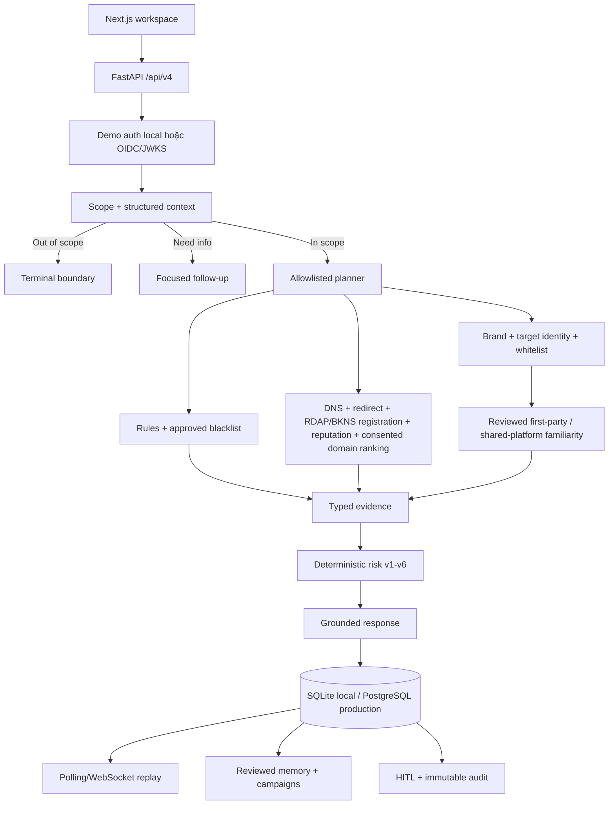

# Product and Architecture

Tài liệu canonical cho phạm vi, contract và kiến trúc TrustGuard AI. Xem trạng thái tại
[CURRENT_STATUS.md](CURRENT_STATUS.md).

## Product boundary

TrustGuard AI hỗ trợ đánh giá tin nhắn hoặc URL đáng ngờ trước khi người dùng chuyển tiền, đăng nhập,
cung cấp OTP/thông tin cá nhân hoặc thực hiện hành động có rủi ro.

In scope: phishing, credential/OTP theft, giả mạo thương hiệu, financial/recruitment/promotion scam,
URL investigation có consent, multi-turn case, report/appeal và Security Admin review.

Out of scope: general news/politics/sports/science/medical fact-check, deepfake detection, malware sandbox,
tư vấn đầu tư và wide action chưa có execution sink được duyệt. Yêu cầu ngoài phạm vi kết thúc bằng
`OUT_OF_SCOPE_GENERAL_FACT_CHECK`, không gọi provider và không tạo risk verdict.

## Public contract

Runtime public chỉ cung cấp `/api/v4`. `/api/v2`, `/api/v3` và vector compatibility đã deprecated và bị
gỡ khỏi FastAPI/OpenAPI/frontend.

```text
Scope: IN_SCOPE | NEED_MORE_INFO | OUT_OF_SCOPE_GENERAL_FACT_CHECK
Risk:  SAFE | LOW_RISK | SUSPICIOUS | HIGH_RISK | MALICIOUS | INSUFFICIENT_EVIDENCE
```

Analysis response gồm scope, conversation ID/version, structured context, investigation plan/status,
typed evidence, normalized errors, risk/confidence/threat type, policy version, recommendations, grounded
explanation và limitations. API v4 bao phủ analyses, conversations/chat, events/WebSocket, reports/appeals,
admin review/actions, blacklist lifecycle v4, brand/whitelist, Security Memory, campaigns, intelligence, audit và capabilities.

Frontend MVP dùng một navigation/sidebar thích ứng theo role. User thấy Kiểm tra và Lịch sử; Hồ sơ/Cài đặt nằm
trong menu avatar góc phải và vẫn dùng route `/profile`. `security_admin` thấy thêm Duyệt bảo mật và Tin cậy &
chặn. Các route Observatory/Audit cũ redirect về Trust workspace. Brand, identity candidate, Memory, campaign và
intelligence vẫn là capability backend/nâng cao, không phải bề mặt điều hướng chính của MVP.

## Runtime architecture



Inline là mặc định. Async chỉ được quảng bá khi PostgreSQL, durable worker và configuration đều ready.
PostgreSQL là source of truth; Redis phục vụ rate limit, ticket ngắn hạn và wake-up notification.

## Workflow and invariants

```text
validate request/version → scope/context → boundary hoặc investigation
→ local + consented external tools → trust enrichment → deterministic risk
→ grounded response → persistence → optional HITL/memory/campaign
```

- AI không trực tiếp đặt risk, score, consent, network target hoặc admin decision.
- Rule tạo scope candidate; grounded AI understanding được chạy trước quyết định scope cuối cùng (trừ greeting/capability cục bộ). AI không được hạ một deterministic security-positive signal xuống out-of-scope.
- AI chỉ liên kết entity với URL bằng index của URL đã trích xuất cục bộ. Reviewed target owner được đối chiếu riêng; whitelist không chứng minh URL thuộc entity đang được claim.
- AI planner chỉ sắp thứ tự candidate đang runnable; policy quyết định coverage và AI không được skip evidence step.
- Chat follow-up gửi conversation ID/version và chỉ nhận owner-scoped structured summary đã làm sạch cùng assessment
  hiện tại. Context được đưa cho model dưới dạng untrusted JSON, không gồm raw chat, score/confidence hay evidence ID;
  stale version bị từ chối và chat thường không làm tăng version hoặc persist nội dung mới.
- Frontend chỉ render Markdown giới hạn trong phản hồi chatbot (nhấn mạnh, danh sách, inline code và HTTP(S) link)
  thành React element; không dùng raw HTML. Nội dung người dùng không được diễn giải như Markdown.
- External lookup dùng lựa chọn tổng cấp tài khoản được người dùng quyết định một lần trước lượt phân tích đầu tiên.
  Backend luôn ghi rõ hai cờ consent vào request pipeline; trạng thái `pending` chặn tạo analysis và `denied` chỉ cho
  local/internal checks. Lựa chọn không được suy ra từ AI hoặc nội dung người dùng.
- Domain registration giữ một public evidence/tool type `rdap`: `.vn` dùng BKNS WHOIS v2 khi có key; domain khác
  dùng IANA RDAP và chỉ fallback BKNS khi IANA không công bố RDAP service. BKNS no-hit/lỗi/timeout không chứng minh
  domain an toàn; registrant, nameserver và raw provider payload không đi vào contract hoặc persistence.
- SSRF guard chặn private/local/metadata target và revalidate từng redirect.
- Page capture tự chạy ở frontend cho URL cuối cùng (URL mới nhất) sau khi case có kết quả, owner-scoped theo URL
  index và gửi consent mới cho từng request. Chromium dùng context tạm không cookie/download/service worker,
  không vượt CAPTCHA hoặc access denial, chặn private/local target, popup, active stream và URL tải tệp phổ biến.
  API chỉ trả ảnh viewport với `Cache-Control: no-store`; frontend chỉ giữ Blob mới nhất trong RAM, thu hồi Blob
  trước đó và ảnh không đi vào evidence, conversation hay database.
- Whitelist có provenance và chạy trước negative scoring.
- Provider no-hit/error/timeout, domain age hoặc mismatch riêng lẻ không đủ tạo `MALICIOUS`.
- Domain familiarity là trục riêng với publisher và exact resource. Reviewed platform chỉ xác nhận platform owner;
  popularity chỉ mô tả usage. Hai nguồn này không bao giờ trực tiếp tạo `SAFE`, không giảm threat/context score và
  shared platform không xác minh form/video/post/file do người dùng tạo.
- User reads luôn owner-scoped; admin routes yêu cầu `security_admin`.
- Không lưu raw private message, URL query token, OTP hoặc credential trong memory/audit.
- Admin Copilot chỉ suggestion; action thật cần reviewer, note, evidence và audit.
- Report decision chỉ thực thi remediation được admin chọn rõ. Memory/whitelist ghi reference vào report; blacklist
  chỉ tạo proposal `pending_review`, và chỉ approved reviewed action mới add/disable entry. Rejected/failed action
  chuyển remediation của report sang `failed`, vẫn giữ `admin_action_id` để truy vết và không được trình bày như
  đã chặn thành công.
- Lần phân tích sau vẫn chạy pipeline đầy đủ. Chỉ whitelist/blacklist đang active hoặc reviewed Memory phù hợp mới
  trở thành evidence; report chưa review hoặc bị reject/dismiss không được dùng như risk signal.
- Whitelist, familiarity và official identity là ba khái niệm độc lập: whitelist là ngoại lệ có provenance;
  familiarity xác nhận platform/usage đã review; official identity đánh giá domain ownership và action
  endorsement. Một nguồn không được dùng thay thế hoặc suy rộng cho nguồn còn lại.

Identity discovery là phần mở rộng provider-neutral của official-link verification, không phải pipeline mới.
Official-link verification đã được triển khai hoàn chỉnh trong runtime `/api/v4`; trạng thái release và
hosted validation được theo dõi tại `CURRENT_STATUS.md`, `DEPLOYMENT.md` và `TESTING.md`.
Khi reviewed registry thiếu/ambiguous hoặc chưa biết URL người dùng, coordinator có thể chạy tối đa ba query
được dẫn xuất từ tên entity và literal claim/title đã grounded. Candidate `discovered` không được coi là cache hit
hoàn tất. Riêng `endorsed_third_party_service`, một discovery source độc lập chứa entity/claim và exact link
(kể cả short-link qua guarded redirect) tới đúng URL người dùng đủ tạo association `verified` với confidence thấp
hơn; target không được tự endorse chính nó. Nếu target page independently khớp entity/claim thì confidence tăng.
Ownership của domain và parent relationship vẫn cần hai evidence family trên hai source host. Kết quả resource
được hiển thị `partially_verified`, có TTL 7 ngày, không ghi vào `BrandRecordV4` và không tự tạo kết luận `SAFE`.
Chỉ admin review mới promote thành immutable brand version; third-party endorsement luôn giới hạn ở exact
URL/resource. Khi provenance chỉ tới đúng submitted resource trên third-party host, coordinator giữ path
endorsement hẹp này thay vì suy rộng thành ownership của publisher domain; reviewed authoritative attestor cho
first-party domain vẫn là path ownership riêng.

Với organization/domain chưa từng được review, search chỉ tạo candidate để guarded-fetch, không tạo identity.
Coordinator chỉ tạo `official_controlled` ephemeral khi candidate host tự định danh entity bằng exact normalized
phrase và một host độc lập đã được fetched, qua basic source-quality checks hiện có, chứa exact anchor về host đó;
hai observations phải khác host và không có explicit ownership conflict/deny/redirect mismatch. Source policy có
thể phân loại và ưu tiên attestor, nhưng không được yêu cầu record cho corroborating source hay candidate
organization/domain. Search hit thô không phải evidence. Social, short-link, DNS/RDAP, title/rank và name
similarity chỉ là supporting hoặc bị loại khỏi root establishment. Identity ephemeral chỉ xác minh publisher/
domain ownership; không xác minh arbitrary URL cùng host, social account, hay third-party resource nếu không có
exact provenance riêng.

Report v4 chỉ công bố domain ownership và action endorsement. Việc entity
được nhắc trước “gửi/yêu cầu/thông báo” chỉ tạo grounded claim, không phải impersonation signal. Ownership
discovery/cache chỉ được công bố khi request có cả `official_source_lookup` và `external_url_lookup`; verified
domain không xác minh yêu cầu đăng nhập. Hai evidence projection này trung tính với score và
`official_domain_verified` không phải SAFE signal.

Semantic understanding không nhận quyền tính character offset. Backend tạo span candidate ổn định cho URL,
phrase/action, clause và toàn message; model chỉ chọn span ID. Confidence hoặc span ID thiếu/sai chỉ loại đúng
semantic candidate liên quan. URL và action hiển nhiên vẫn do rule deterministic trích xuất.

Official verification v4 route ownership theo URL và endorsement theo action, không công bố suy đoán/xác minh sender.
Registry miss khởi động resource-first discovery thay vì kết thúc ở `UNVERIFIED`; association đủ hai evidence
family độc lập được cache có TTL bằng identity-candidate store hiện hữu. SAFE dùng chain liên quan đến hành động:
exact resource/action endorsement đã verified có thể đủ khi không có conflict hoặc malicious evidence.

## Persistence and lifecycle

- SQLite là local/test fallback; PostgreSQL/Alembic là production path.
- Conversation dùng optimistic version, redacted summary và retention.
- Durable jobs dùng encrypted payload, lease, idempotency key và transactional outbox.
- Memory ảnh hưởng risk phải reviewed, owner-scoped và không self-match analysis hiện tại.
- Campaign dùng named security signals, không dùng embeddings/vector database.
- Migration `0018_remove_vector_compat` xóa fact-check/source-discovery/vector storage cũ và không downgrade.
- Migration `0019_security_identity_discovery` thêm candidate versions, immutable typed observations và immutable
  reviewer decisions riêng cho Security v4; SQLite fallback có schema tương đương.
- Migration `0020_report_audit_details` lưu structured report resolution/remediation trong immutable feedback audit.
- Migration `0021_security_blacklist_v4` cho phép proposal mới sau lifecycle terminal, giữ duy nhất một proposal
  pending theo action/target và thêm `blacklist` vào unified audit; SQLite migration v6 lưu proposal/review qua restart.
- Migration `0022_action_assurance_metadata` thêm JSONB `policy_metadata` cho analysis security-risk-v7 và reserve
  JSONB `assurance_metadata` cho feedback audit. Analysis repository ghi policy metadata cạnh canonical response;
  audit assurance column hiện dùng default `{}` cho tới khi writer được nối end-to-end. Các cột companion này chỉ
  chứa metadata tối thiểu, không chứa private message, raw model output, credential hoặc URL query.
- PostgreSQL repository giữ một facade tương thích và tách implementation theo domain thành các mixin feedback,
  jobs/outbox, trust và Wave 2 để giảm kích thước module và cho phép kiểm thử từng miền độc lập.

## Code map

| Area | Location |
|---|---|
| App/config/auth | `src/main.py`, `src/config.py`, `src/core/` |
| API v4 | `src/api/security_v4.py` |
| Scope/investigation/risk | `src/agents/security_*.py` |
| Services | `src/services/security_*.py` |
| Persistence | `src/repositories/postgres.py`, `src/repositories/postgres_*.py`, `migrations/versions/` |
| AI/evaluation | `src/security_ai/`, `src/evaluation/` |
| Frontend/tests | `frontend/src/`, `tests/` |
