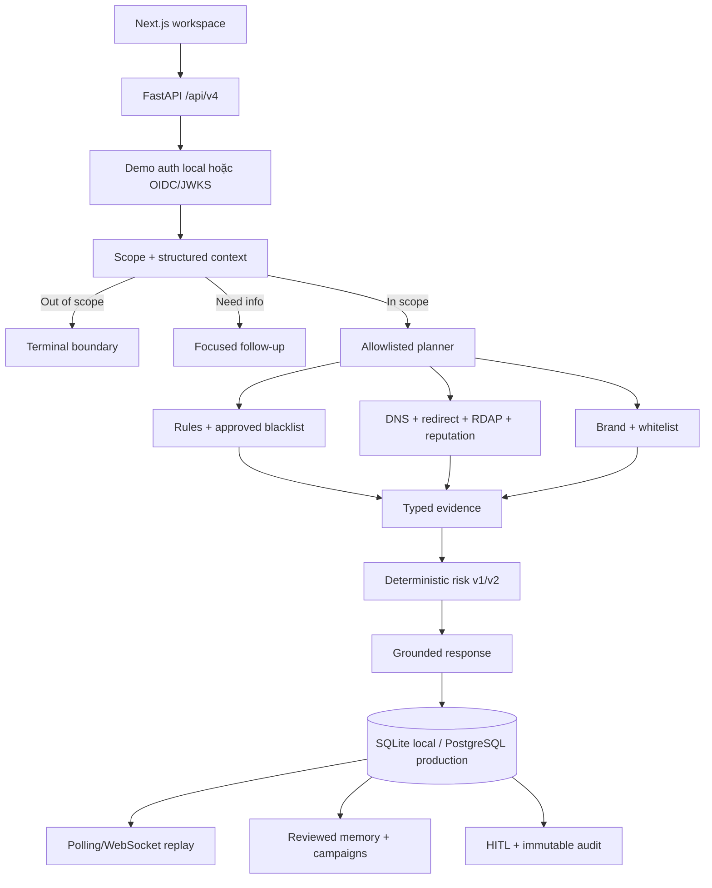

# Product and Architecture

Tài liệu canonical cho phạm vi, contract và kiến trúc TrustGuard AI. Xem trạng thái tại
[CURRENT_STATUS.md](CURRENT_STATUS.md).

## Product boundary

TrustGuard AI hỗ trợ đánh giá tin nhắn hoặc URL đáng ngờ trước khi người dùng chuyển tiền, đăng nhập,
cung cấp OTP/thông tin cá nhân hoặc thực hiện hành động có rủi ro.

In scope: phishing, credential/OTP theft, giả mạo thương hiệu, financial/recruitment/promotion scam,
URL investigation có consent, multi-turn case, report/appeal và Security Admin review.

Out of scope: general news/politics/sports/science/medical fact-check, deepfake detection, malware sandbox,
tư vấn đầu tư và wide action chưa có execution sink được duyệt. Yêu cầu ngoài phạm vi kết thúc bằng
`OUT_OF_SCOPE_GENERAL_FACT_CHECK`, không gọi provider và không tạo risk verdict.

## Public contract

Runtime public chỉ cung cấp `/api/v4`. `/api/v2`, `/api/v3` và vector compatibility đã deprecated và bị
gỡ khỏi FastAPI/OpenAPI/frontend.

```text
Scope: IN_SCOPE | NEED_MORE_INFO | OUT_OF_SCOPE_GENERAL_FACT_CHECK
Risk:  SAFE | LOW_RISK | SUSPICIOUS | HIGH_RISK | MALICIOUS | INSUFFICIENT_EVIDENCE
```

Analysis response gồm scope, conversation ID/version, structured context, investigation plan/status,
typed evidence, normalized errors, risk/confidence/threat type, policy version, recommendations, grounded
explanation và limitations. API v4 bao phủ analyses, conversations/chat, events/WebSocket, reports/appeals,
admin review/actions, brand/whitelist, Security Memory, campaigns, intelligence, audit và capabilities.

## Runtime architecture



Inline là mặc định. Async chỉ được quảng bá khi PostgreSQL, durable worker và configuration đều ready.
PostgreSQL là source of truth; Redis phục vụ rate limit, ticket ngắn hạn và wake-up notification.

## Workflow and invariants

```text
validate request/version → scope/context → boundary hoặc investigation
→ local + consented external tools → trust enrichment → deterministic risk
→ grounded response → persistence → optional HITL/memory/campaign
```

- AI không trực tiếp đặt risk, score, consent, network target hoặc admin decision.
- External lookup cần consent của request hiện tại; consent không kế thừa qua conversation.
- SSRF guard chặn private/local/metadata target và revalidate từng redirect.
- Whitelist có provenance và chạy trước negative scoring.
- Provider no-hit/error/timeout, domain age hoặc mismatch riêng lẻ không đủ tạo `MALICIOUS`.
- User reads luôn owner-scoped; admin routes yêu cầu `security_admin`.
- Không lưu raw private message, URL query token, OTP hoặc credential trong memory/audit.
- Admin Copilot chỉ suggestion; action thật cần reviewer, note, evidence và audit.

## Persistence and lifecycle

- SQLite là local/test fallback; PostgreSQL/Alembic là production path.
- Conversation dùng optimistic version, redacted summary và retention.
- Durable jobs dùng encrypted payload, lease, idempotency key và transactional outbox.
- Memory ảnh hưởng risk phải reviewed, owner-scoped và không self-match analysis hiện tại.
- Campaign dùng named security signals, không dùng embeddings/vector database.
- Migration `0018_remove_vector_compat` xóa fact-check/source-discovery/vector storage cũ và không downgrade.

## Code map

| Area | Location |
|---|---|
| App/config/auth | `src/main.py`, `src/config.py`, `src/core/` |
| API v4 | `src/api/security_v4.py` |
| Scope/investigation/risk | `src/agents/security_*.py` |
| Services | `src/services/security_*.py` |
| Persistence | `src/repositories/`, `migrations/versions/` |
| AI/evaluation | `src/security_ai/`, `src/evaluation/` |
| Frontend/tests | `frontend/src/`, `tests/` |

