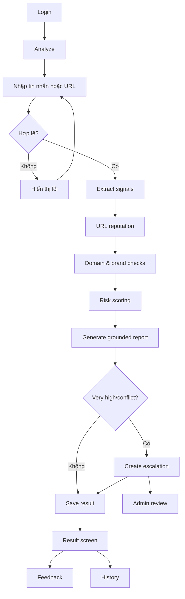

# WIREFRAME & UI FLOW

## UI Flow



## Screen 1 — Login

```text
┌─────────────────────────────────────┐
│ TrustGuard AI                       │
│ Email    [_______________________]   │
│ Password [_______________________]  │
│ [ Đăng nhập ]                       │
└─────────────────────────────────────┘
```

## Screen 2 — Analyze

```text
┌────────────┬──────────────────────────────┐
│ Analyze    │ Dán tin nhắn hoặc URL       │
│ History    │ ┌──────────────────────────┐ │
│            │ │ Tài khoản sắp bị khóa...│ │
│            │ │ https://...             │ │
│            │ └──────────────────────────┘ │
│            │ [ Phân tích ]               │
└────────────┴──────────────────────────────┘
```

## Screen 3 — Processing

```text
✓ Trích xuất URL và tín hiệu
✓ Chuẩn hóa domain
… Kiểm tra reputation
… Tra cứu domain
○ Tính risk score
○ Tổng hợp báo cáo
```

## Screen 4 — Result

```text
[ RỦI RO CAO ] 75/100
Loại: Credential phishing

Dấu hiệu
- Tạo áp lực thời gian
- Yêu cầu đăng nhập
- Domain không khớp thương hiệu

Bằng chứng
- Reputation: suspicious
- Domain age: 12 ngày

Khuyến nghị
- Không đăng nhập qua link
- Mở app/website chính thức

Giới hạn
- Không bị đánh dấu không bảo đảm an toàn

[ Hữu ích ] [ Cảnh báo sai ] [ Báo cáo ]
```

## Screen 5 — History
Danh sách thời gian, domain, risk level, trạng thái feedback.

## Screen 6 — Admin Cases
Danh sách case open/very high/resolved và nút Review.

## Screen 7 — Admin Case Detail
Original input, signals, tool evidence, scoring, reviewer note và ba quyết định:
- Confirm scam
- False positive
- Inconclusive