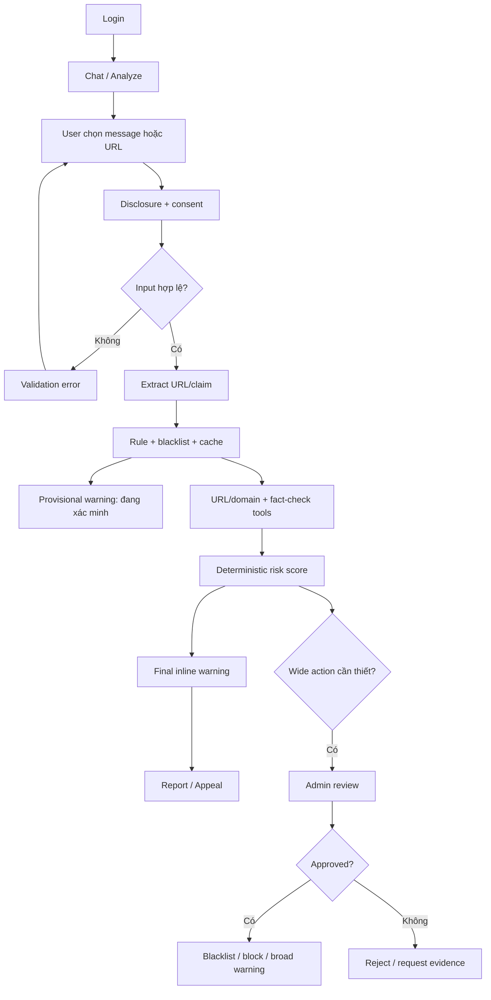

# WIREFRAME & UI FLOW — TRUSTGUARD AI

## 1. User flow tổng quát



## 2. Login

```text
┌─────────────────────────────────────┐
│ TrustGuard AI                       │
│ Email    [_______________________]   │
│ Password [_______________________]  │
│ [ Đăng nhập ]                       │
└─────────────────────────────────────┘
```

Production dùng IdP/session auth. Demo token/local role chỉ được ghi rõ là development mode.

## 3. Chat / Analyze và consent

```text
┌────────────┬────────────────────────────────────────────┐
│ Analyze    │ Dán message hoặc URL bạn muốn kiểm tra     │
│ History    │ ┌────────────────────────────────────────┐ │
│ Appeals    │ │ Tài khoản sắp bị khóa... https://...  │ │
│            │ └────────────────────────────────────────┘ │
│            │ [✓] Cho phép tra URL/domain qua provider   │
│            │ Dữ liệu gửi đi: URL/domain đã chuẩn hóa.   │
│            │ [ Phân tích ]                              │
└────────────┴────────────────────────────────────────────┘
```

Disclosure phải nói rõ hệ thống chỉ xử lý nội dung đang chọn, không đọc toàn bộ private chat và
external provider có thể quan sát URL/domain. Screenshot advanced có consent riêng khi được đề xuất.

## 4. Provisional warning và processing

```text
┌─────────────────────────────────────────────────────────┐
│ ⚠ ĐANG XÁC MINH — Hãy thận trọng với liên kết này      │
│ Lý do sơ bộ: domain gần giống thương hiệu, yêu cầu login│
│ Không nhập mật khẩu/OTP trong lúc hệ thống kiểm tra.     │
├─────────────────────────────────────────────────────────┤
│ ✓ Trích xuất URL và claim                               │
│ ✓ Kiểm tra local rules                                  │
│ ✓ Tra approved blacklist                               │
│ … URL reputation / redirect                            │
│ … RDAP/WHOIS                                            │
│ … Fact-check                                            │
└─────────────────────────────────────────────────────────┘
```

Banner sơ bộ không dùng từ “an toàn” hoặc trình bày như verdict cuối. WebSocket cập nhật timeline;
polling fallback tiếp tục khi kết nối realtime bị ngắt.

## 5. Final inline warning

```text
┌─────────────────────────────────────────────────────────┐
│ [ RỦI RO CAO ] 78/100 · suspicious                     │
│ Liên kết có dấu hiệu giả mạo và chưa được xác nhận.      │
│                                                         │
│ Vì sao                                                  │
│ • Domain không khớp nguồn chính thức                    │
│ • Trang yêu cầu đăng nhập và tạo áp lực thời gian       │
│                                                         │
│ Bằng chứng                                              │
│ • Reputation: suspicious · nguồn · thời gian            │
│ • RDAP: domain mới đăng ký · nguồn · thời gian           │
│                                                         │
│ Giới hạn                                                │
│ • Provider no-hit không bảo đảm URL an toàn             │
│                                                         │
│ Khuyến nghị: mở app/website chính thức, không nhập OTP. │
│ [ Hữu ích ] [ Báo sai ] [ Appeal ]                     │
└─────────────────────────────────────────────────────────┘
```

URL đáng ngờ hiển thị dạng text đã escape/redact, không là anchor trực tiếp. Evidence có source và
observed time; limitation luôn hiện khi coverage thiếu hoặc provider lỗi.

## 6. History và appeal

History có thời gian, domain đã redact phù hợp, risk level, trạng thái analysis/report/appeal.

```text
┌─────────────────────────────────────────────────────────┐
│ Appeal cảnh báo                                         │
│ Lý do [Cảnh báo nhầm ▼]                                 │
│ Ghi chú [___________________________________________]    │
│ [ Gửi appeal ]                                          │
│ Trạng thái: submitted → under_review → resolved         │
└─────────────────────────────────────────────────────────┘
```

Appeal chỉ sửa kết quả vận hành qua corrective decision; không xóa audit hoặc tự huấn luyện model.

## 7. Admin review

```text
┌──────────────────────────────────────────────────────────────┐
│ Case / Appeal detail                                        │
│ Risk, evidence snapshot, limitations, provider status        │
│ Related campaign hypothesis (nếu có)                         │
│                                                              │
│ Decision [Approve ▼]  Action [Add to blacklist ▼]            │
│ Reviewer note [_________________________________________]     │
│ [ Submit reviewed decision ]                                 │
└──────────────────────────────────────────────────────────────┘
```

Action gồm no-op, blacklist add/disable, block domain và broad warning. UI không cho submit action
diện rộng thiếu note/evidence; backend vẫn là hard gate cuối và lưu audit atomically.

## 8. Admin operations dashboard — nâng cao

- Trend theo claim/domain/time window và campaign hypotheses chờ review.
- Precision/false-positive, report/appeal outcome và review SLA.
- Provisional/final latency, cache hit, tool/LLM calls, token/cost, quota, 429/timeout.
- Không hiển thị raw private message, prompt, OTP/secret hoặc sender social graph.

## 9. UI states bắt buộc

- Loading, empty, validation error, forbidden, provider-limited, failed và offline/reconnect.
- `inconclusive` khác `safe`; provisional khác final; reviewed khác auto-generated.
- Admin approval đang xử lý phải chống double-submit và hiển thị conflict nếu case đã được review.
- Screenshot consent/timeout và appeal submitted/resolved có trạng thái riêng.
